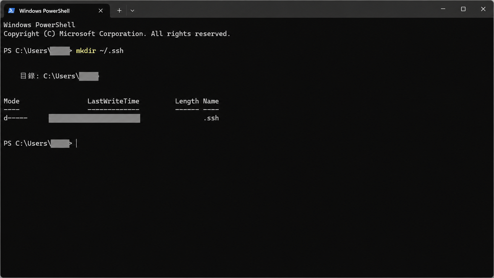
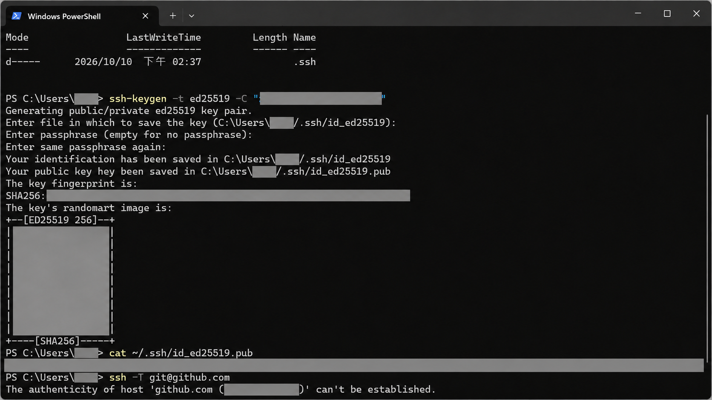
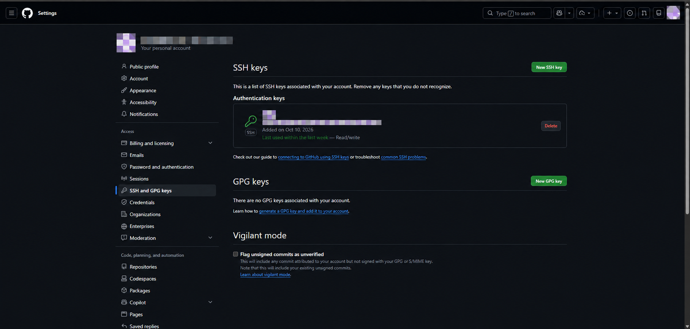
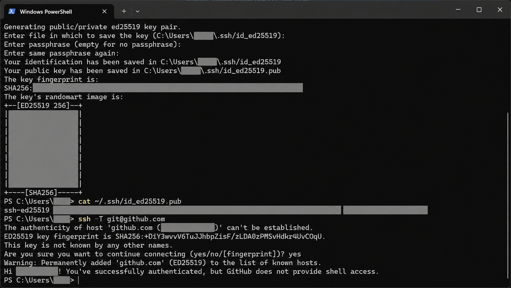

# Windows 使用 SSH 連接 GitHub：從金鑰設定到 Clone 專案

使用 SSH 連接 GitHub，可以透過本機的金鑰驗證身分，進行 git clone、pull 與 push。這篇以 Windows PowerShell 為例，從建立金鑰、加入 GitHub，到測試連線與下載專案，一步一步完成設定。

## 開始前的準備

準備一個 GitHub 帳號，並安裝 Git for Windows 與 Windows OpenSSH 用戶端。開啟 PowerShell，確認下列指令可以執行：

```powershell
git --version
ssh -V
```

若找不到 ssh 或 ssh-keygen，可在 Windows「設定 → 選用功能」檢查並安裝「OpenSSH 用戶端」。以下指令皆在 PowerShell 執行；~ 代表目前使用者的家目錄，例如 C:\Users\YOUR_USER。

## 1. 檢查既有金鑰，建立 .ssh 資料夾

```powershell
Get-ChildItem "$env:USERPROFILE\.ssh" -ErrorAction SilentlyContinue
New-Item -ItemType Directory -Force "$env:USERPROFILE\.ssh"
```

如果已經有 id_ed25519 與 id_ed25519.pub，可以沿用既有金鑰，直接前往加入公鑰的步驟。若要建立另一組，請使用不同檔名，避免覆寫仍在使用的金鑰。

第一次建立資料夾時，也可以像下圖使用 mkdir ~/.ssh；本文使用 New-Item -Force，讓資料夾已存在時也能執行。



建立存放 SSH 金鑰的資料夾。

## 2. 產生 ED25519 金鑰

將下列信箱換成自己的信箱。-C 是方便辨識金鑰的註解，不是登入密碼。

```powershell
ssh-keygen -t ed25519 -C "your_email@example.com"
```

接下來會依序出現三個提示：

1. `Enter file in which to save the key`：按 Enter 使用預設路徑 ~/.ssh/id_ed25519。如果提示檔案已存在，請勿直接同意覆寫。
1. `Enter passphrase (empty for no passphrase)`：建議設定保護私鑰的密語；輸入時畫面不會顯示字元。直接按 Enter 則是不設定密語。
1. `Enter same passphrase again`：再次輸入相同密語。

完成後會產生兩個檔案：

- `id_ed25519`：私鑰，留在自己的電腦，不要上傳到 GitHub、加入 Git 儲存庫或分享給其他人。
- `id_ed25519.pub`：公鑰，接下來要加入 GitHub 帳號。



產生金鑰後，使用 cat 顯示 .pub 公鑰。截圖中的個人信箱、公鑰、個人金鑰指紋及帳號資訊已遮蔽；操作時請使用自己的資料。

## 3. 將公鑰加入 GitHub

在 PowerShell 中複製公鑰到剪貼簿：

```powershell
Get-Content "$env:USERPROFILE\.ssh\id_ed25519.pub" | Set-Clipboard
```

也可以執行 `cat ~/.ssh/id_ed25519.pub` 查看內容，再複製完整的一行，從 ssh-ed25519 開頭直到最後的註解。不要複製命令提示字元。

1. 登入 GitHub，點選右上角頭像 → **Settings**。
1. 進入 **SSH and GPG keys** → **New SSH key**，也可直接開啟 [SSH 金鑰設定頁](https://github.com/settings/keys)。
1. Title 填入可辨識的名稱，例如「Windows 桌機」。
1. Key type 選擇 **Authentication Key**。
1. 將公鑰貼入 Key 欄位，點選 **Add SSH key**，並依提示完成帳號確認。

這一步讓 GitHub 知道哪一把公鑰屬於你的帳號；只有在本機產生金鑰，尚未完成 GitHub 帳號設定。



加入成功後，會在 **Authentication keys** 下看到這把 SSH 金鑰。截圖中的姓名、帳號、頭像、金鑰名稱與個人金鑰指紋已馬賽克。

## 4. 測試 SSH 連線

```powershell
ssh -T git@github.com
```

這裡的使用者名稱固定是 git，不要替換成自己的 GitHub 帳號。第一次連線可能看到：

```text
The authenticity of host 'github.com (IP ADDRESS)' can't be established.
ED25519 key fingerprint is SHA256:+DiY3wvvV6TuJJhbpZisF/zLDA0zPMSvHdkr4UvCOqU.
Are you sure you want to continue connecting (yes/no/[fingerprint])?
```

這表示電腦還沒有記錄 GitHub 伺服器的身分。先比對 [GitHub 官方 SSH 指紋](https://docs.github.com/en/authentication/keeping-your-account-and-data-secure/githubs-ssh-key-fingerprints)；本文範例的 ED25519 指紋與官方公布值一致。確認相符後，輸入 yes 並按 Enter。若不相符，先停止連線並查明原因，不能只因為主機名稱是 github.com 就接受。

這個伺服器指紋與 ssh-keygen 產生的「你自己的金鑰指紋」不同，不需要兩者相同。IP 位址也可能因連線位置不同而改變。

```text
Warning: Permanently added 'github.com' (ED25519) to the list of known hosts.
Hi YOUR_USERNAME! You've successfully authenticated, but GitHub does not provide shell access.
```

Permanently added 表示 GitHub 的主機金鑰已存入 ~/.ssh/known_hosts，是正常訊息。Hi 後面的帳號應該是自己的 GitHub 帳號；successfully authenticated 表示驗證成功。GitHub 不提供一般 SSH 互動式終端，因此 does not provide shell access 也不是設定失敗。這項測試成功時仍可能回傳結束代碼 1，請以驗證訊息判斷結果。



確認伺服器金鑰後，成功使用 SSH 驗證 GitHub 帳號。

## 5. 使用 SSH 下載專案

在 GitHub 儲存庫頁面點選 Code → SSH，複製網址。以下使用通用佔位符示範；請將 OWNER 與 REPOSITORY 替換成儲存庫擁有者與專案名稱。

```powershell
Set-Location D:\Github
git clone git@github.com:OWNER/REPOSITORY.git
Set-Location REPOSITORY
```

請先確認 D:\Github 已存在，或切換到你想存放專案的資料夾。看到 Receiving objects: 100% 與 Resolving deltas: 100%，且沒有錯誤訊息，就表示下載完成。如果 Git 與 PowerShell 使用不同的 SSH 用戶端，clone 時可能再次詢問主機指紋，仍需先比對官方資料。

若專案原本使用 HTTPS，可在該專案資料夾改成 SSH 網址：

```powershell
git remote -v
git remote set-url origin git@github.com:OWNER/REPOSITORY.git
git remote -v
```

請替換 OWNER 與 REPOSITORY。SSH 驗證成功仍需有儲存庫的存取權限，才能讀取私人專案或推送修改。

## 選用：用 ssh-agent 記住金鑰密語

如果金鑰有設定密語，又不想每次連線都輸入，可以使用 Windows 的 ssh-agent。先以系統管理員身分開啟 PowerShell，執行：

```powershell
Get-Service ssh-agent | Set-Service -StartupType Automatic
Start-Service ssh-agent
```

接著回到自己帳號的一般 PowerShell，加入私鑰：

```powershell
ssh-add "$env:USERPROFILE\.ssh\id_ed25519"
ssh-add -l
```

若 PowerShell 已記住密語，但 git push 仍要求輸入，可能是 Git for Windows 使用另一套 SSH。確認 Windows OpenSSH 已安裝後，可讓 Git 改用 Windows 的用戶端：

```powershell
git config --global core.sshCommand "C:/Windows/System32/OpenSSH/ssh.exe"
```

這是對目前使用者所有 Git 儲存庫生效的設定。如果只想套用目前專案，可改用 --local；若原本已有自訂 SSH 設定，請先確認是否需要保留。

## 常見問題

### Permission denied (publickey)

表示 GitHub 未接受目前提供的金鑰。檢查 .pub 公鑰是否完整加入正確帳號、私鑰是否在預設位置，以及 ssh-add -l 是否列出預期金鑰。可以用下列指令指定私鑰測試：

```powershell
ssh -T -i "$env:USERPROFILE\.ssh\id_ed25519" -o IdentitiesOnly=yes git@github.com
```

### Repository not found

確認儲存庫網址是否正確、專案是否存在，以及目前驗證的 GitHub 帳號是否有存取權限。

### REMOTE HOST IDENTIFICATION HAS CHANGED!

這與第一次連線的確認不同：表示目前主機金鑰與已記錄值不同。先查核 GitHub 官方公告與指紋，確認變更原因後再處理 known_hosts，不要直接刪除紀錄並接受新金鑰。

## 官方參考資料

- [產生 SSH 金鑰與設定 ssh-agent（Windows）](https://docs.github.com/en/authentication/connecting-to-github-with-ssh/generating-a-new-ssh-key-and-adding-it-to-the-ssh-agent?platform=windows)
- [將公鑰加入 GitHub 帳號](https://docs.github.com/en/authentication/connecting-to-github-with-ssh/adding-a-new-ssh-key-to-your-github-account)
- [測試 SSH 連線](https://docs.github.com/en/authentication/connecting-to-github-with-ssh/testing-your-ssh-connection)
- [GitHub SSH 主機指紋](https://docs.github.com/en/authentication/keeping-your-account-and-data-secure/githubs-ssh-key-fingerprints)
