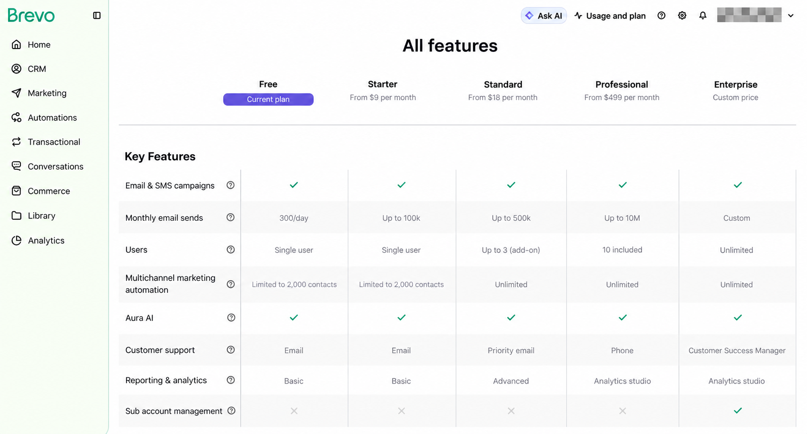
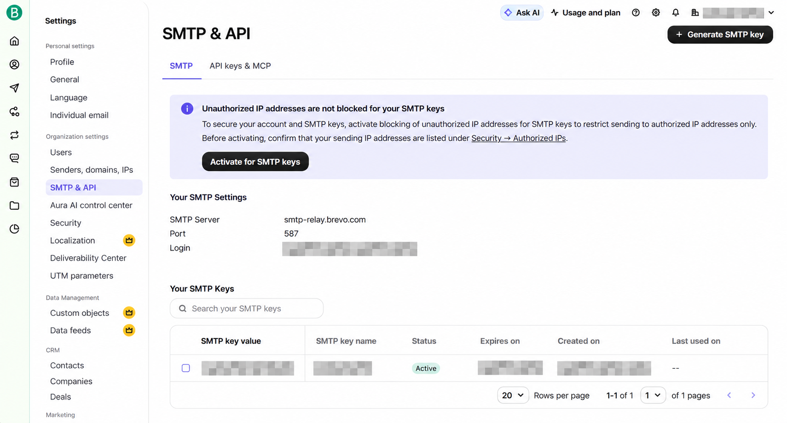

圖書管理系統需要寄送註冊驗證、密碼重設和借閱提醒。這次我選擇 Brevo 的免費 SMTP，先確認帳號方案，再取得 SMTP 憑證，最後從本機透過 TLS 寄出一封測試信。

過程中最容易搞混的是三件事：付費選購頁沒有列出免費版、SMTP login 不一定是自己的 Gmail，以及 SMTP key 和 API key 用途不同。本文按操作順序整理。

本文依 2026 年 10 月的操作畫面與官方文件撰寫，方案及介面可能調整。圖片以操作截圖經影像工具遮蔽、重整後作為位置示意；帳號、SMTP login、key 及日期資訊已做馬賽克處理，文字範例全部使用佔位值。

## 一、先確認目前是否已是免費方案

Brevo 的免費方案目前提供每天 300 封郵件。這是每日額度，不能視為可一次使用的整月額度。[官方免費額度說明](https://help.brevo.com/hc/en-us/articles/208580669-FAQs-What-are-the-limits-of-the-Free-plan)

註冊後若看到 Starter、Standard 等付費卡片，不代表必須付款。我這次先進入方案選購頁，只看到付費選項；後來回到後台的 **Usage and plan**，才確認 **Free** 下方已標示 **Current plan**，額度為 **300/day**。



請以自己帳號顯示的目前方案為準。若已是 Free，就直接繼續設定 SMTP，不需要再選 Starter。

## 二、建立寄件者並驗證網域

進入 **Settings → Senders, domains, IPs**，建立寄件者名稱及寄件信箱，依後台指示完成驗證。

正式使用時，準備自己可管理 DNS 的寄件網域，依 Brevo 提供的值加入 Brevo code、DKIM 及 DMARC 記錄，再回到後台驗證。`xxx.onrender.com` 是網站網址，不代表可以管理該網域的寄信 DNS；一般個人 Gmail 也無法讓你修改 `gmail.com` 的 DNS。

操作以 [Brevo 網域驗證教學](https://help.brevo.com/hc/en-us/articles/12163873383186-Authenticate-your-domain-with-Brevo-Brevo-code-DKIM-DMARC) 為準。不能只填入任意信箱，就假設寄件者已獲授權。

## 三、找到 SMTP login 並建立 key

進入 **Settings → SMTP & API → SMTP**。這個頁面會列出 SMTP server、Port、Login，以及已建立的 SMTP keys。



圖中左側的 **Senders, domains, IPs** 是寄件者設定入口；右上角 **Generate SMTP key** 用來建立 SMTP 密鑰。圖片經影像工具處理，請以自己後台的實際數值為準。

按下 **Generate SMTP key**，取一個方便辨識的名稱，例如 `Library Development`，將完整 key 保存到密碼管理工具或本機秘密設定。列表只顯示遮罩時，不能把星號或末幾碼當成密碼；若沒有保存完整值，可建立新 key 再更新應用程式。

| 欄位 | 應填內容 |
|---|---|
| SMTP server | `smtp-relay.brevo.com` |
| SMTP login | 後台顯示的 Login，可能形如 `your-id@smtp-brevo.com` |
| SMTP password | 產生的完整 SMTP key |
| From email | 已完成寄件者設定的信箱 |

SMTP login、寄件信箱與收件信箱是不同角色。Brevo 的 SMTP login 有時是帳號信箱，有時是自動產生的地址，應直接使用後台顯示值；SMTP 密碼則必須是 SMTP key。[官方 SMTP 設定文件](https://help.brevo.com/hc/en-us/articles/7924908994450-Send-transactional-emails-using-Brevo-SMTP)

## 四、設定 ASP.NET Core

Library 使用 MailKit 寄信，設定集中於 `EmailSettings`。開發環境可將下列非秘密設定放進 `appsettings.Development.json`：

```json
{
  "EmailSettings": {
    "SmtpHost": "smtp-relay.brevo.com",
    "SmtpPort": 2525,
    "SmtpUser": "your-id@smtp-brevo.com",
    "FromName": "圖書管理系統",
    "UseSsl": false
  }
}
```

SMTP key 改放 User Secrets。在專案目錄執行以下指令，已有 UserSecretsId 的專案可略過初始化：

```powershell
dotnet user-secrets init --project Library.Server
dotnet user-secrets set "EmailSettings:SmtpPass" "<YOUR_SMTP_KEY>" --project Library.Server
dotnet user-secrets set "EmailSettings:FromEmail" "sender@example.com" --project Library.Server
```

以上為設定範例，替換佔位值後才可使用。User Secrets 用於本機開發，不會自動部署到 Render；也不要把填入真實 key 的指令截圖公開。

MailKit 連線可以明確要求 STARTTLS，驗證 SMTP 身分後再寄信：

```csharp
using MailKit.Net.Smtp;
using MailKit.Security;
using MimeKit;

var settings = configuration.GetSection("EmailSettings");
var message = new MimeMessage();
message.From.Add(new MailboxAddress(
    settings["FromName"], settings["FromEmail"]));
message.To.Add(MailboxAddress.Parse("recipient@example.com"));
message.Subject = "Library Brevo SMTP test";
message.Body = new TextPart("plain") { Text = "這是一封 SMTP 測試信。" };

using var smtp = new SmtpClient();
smtp.Timeout = 30000;
await smtp.ConnectAsync(settings["SmtpHost"],
    int.Parse(settings["SmtpPort"] ?? "2525"),
    SecureSocketOptions.StartTls);
await smtp.AuthenticateAsync(settings["SmtpUser"], settings["SmtpPass"]);
await smtp.SendAsync(message);
await smtp.DisconnectAsync(true);
```

這段是整合片段，`configuration` 需由應用程式取得。Library 原有程式使用 `ConnectAsync(host, port, useSsl)`；其中 `false` 表示不以隱含 TLS 起始連線，不能直接解讀成整段傳輸必然不加密。本文範例改成明確要求 STARTTLS，若無法升級 TLS 就讓連線失敗。

## 五、Render 使用 2525 連接埠

Render 免費 Web Service 封鎖對外的 `25`、`465` 和 `587`。即使 Brevo 頁面顯示 587，部署設定仍需配合主機限制；本例使用 Brevo 支援的 2525。[Render 免費服務限制](https://render.com/docs/free)、[Brevo SMTP 連接說明](https://help.brevo.com/hc/en-us/articles/115000188150-Troubleshooting-Issues-with-Brevo-SMTP)

在 **Render → 服務 → Environment** 加入：

```ini
EmailSettings__SmtpHost=smtp-relay.brevo.com
EmailSettings__SmtpPort=2525
EmailSettings__UseSsl=false
EmailSettings__SmtpUser=your-id@smtp-brevo.com
EmailSettings__SmtpPass=<YOUR_SMTP_KEY>
EmailSettings__FromEmail=sender@example.com
EmailSettings__FromName=圖書管理系統
FrontendBaseUrl=https://your-service.onrender.com
```

雙底線會對應 ASP.NET Core 的巢狀設定，例如 `EmailSettings__SmtpPass` 對應 `EmailSettings:SmtpPass`。這些設定應放在後端執行環境，不能使用會公開到前端程式的 `VITE_` 變數。

`FrontendBaseUrl` 是 Library 產生驗證與密碼重設連結使用的設定，請填網站正式網址。儲存後重新部署，再測試網站流程。

## 六、這次實測確認到哪裡？

這次從本機以 Python SMTP 用戶端連到 Brevo 的 2525，完成 STARTTLS，使用 SMTP login 與 key 驗證，寄一封測試信到自己的信箱。測試輸出如下：

```text
SMTP authentication succeeded
SMTP accepted test message; refused recipients: 0
```

這代表 SMTP 驗證成功，而且 Brevo 已接受這封信、沒有拒絕指定收件者。**這不是 Gmail 收件匣送達證明，也不是 Render 或網站寄信流程已驗收。** 接著還要查看收件匣、垃圾郵件，以及 Brevo **Transactional → Logs** 的結果。

網站端則分別測試註冊驗證信和忘記密碼，確認信件能收到、連結指向正確網站，以及點擊後能完成操作。Library 的借閱通知另有 `Circulation__EmailEnabled=true` 開關；啟用前先確認基本寄信流程，並留意有效的待寄通知可能隨後被處理。

## 七、常見問題

| 現象 | 優先檢查 |
|---|---|
| SMTP 驗證失敗 | Login 是否照後台填寫、密碼是否為完整 SMTP key，而非 API key |
| 本機可寄、Render 逾時 | 是否仍使用被封鎖的 587，改查 2525 的連線結果 |
| 寄件者被拒絕 | FromEmail 是否已在 Brevo 完成設定，寄件網域是否通過驗證 |
| SMTP 接受但沒看到信 | 收件匣、垃圾郵件、Brevo Logs 中的退信或投遞狀態 |
| 驗證信連到 localhost | 後端的 FrontendBaseUrl 是否已改成正式網址 |
| 新增設定後仍不生效 | 是否重新啟動、執行環境是否正確，以及是否有環境變數覆寫 |

若 SMTP key 曾公開到文章、截圖或 Git，應在 Brevo 撤銷並重建，再更新應用程式設定。本文不包含實際 key、個人信箱或可還原的原始截圖。
