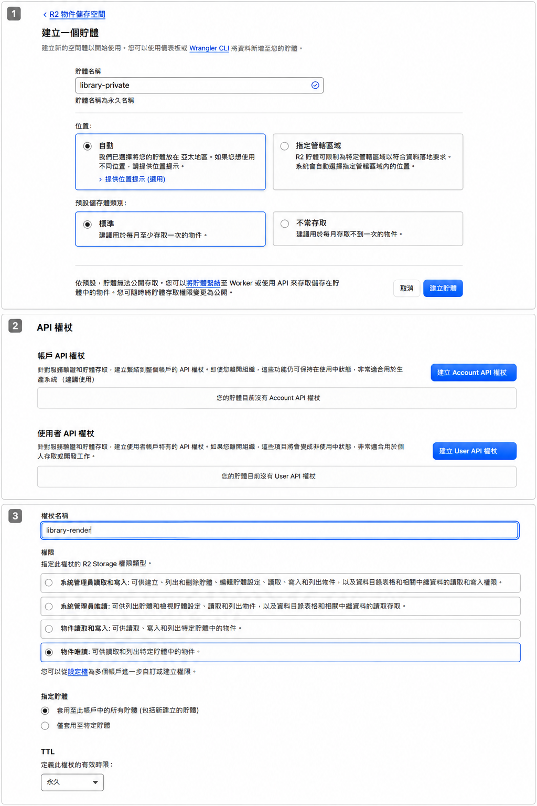
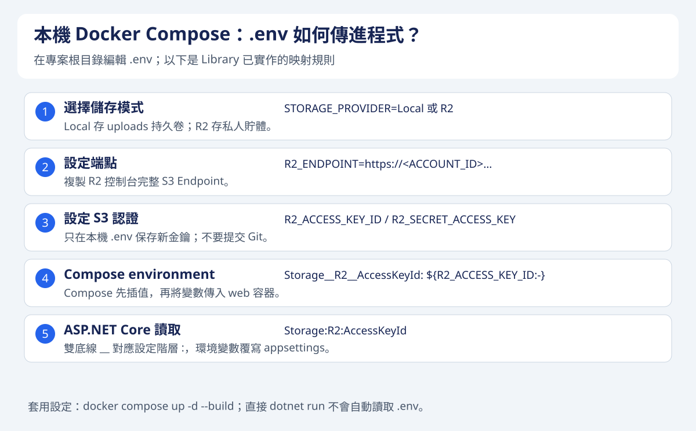
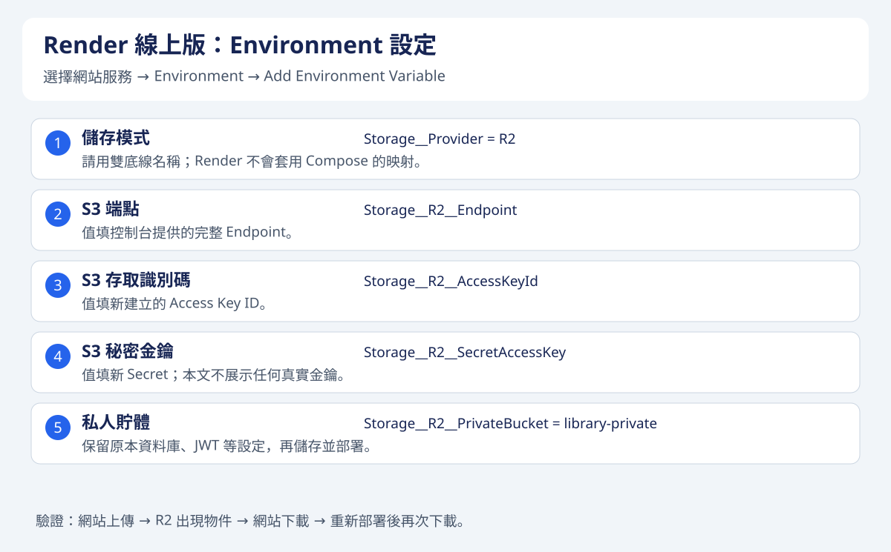

將網站部署到 Render 之後，程式可以重新建置，但使用者上傳的 PDF、圖片和附件不能每次部署都消失。這篇延續 [Render＋Supabase 部署教學](../render-supabase-docker/)，把 Library 的附件改存 Cloudflare R2，同時保留本機開發用的本地儲存模式。

本文以 2026 年 11 月的操作介面與專案設定為例。所有憑證使用佔位值，請填自己的新金鑰。本文的設定名稱對應 Library 已實作的儲存功能；其他專案需要先完成程式串接，單填環境變數不會自動啟用 R2。

本文的 R2 操作配圖取自先前實際操作截圖，經影像工具裁切、整理與遮蔽個資。環境變數對照圖另以示意圖補充；設定值以文字教學為準，不公開實際金鑰。

## 一、網站、資料庫與附件分別放哪裡？

| 元件 | 本機開發 | 線上部署 |
|---|---|---|
| ASP.NET Core API 與 Vue | 本機或 Docker | Render |
| 書籍、帳號、附件資訊 | 原有 SQL Server 或 PostgreSQL | 原有雲端資料庫 |
| 使用者上傳的檔案內容 | `wwwroot/uploads` | R2 私人貯體 |

資料庫保存檔名、大小、上傳者和物件位置，R2 保存檔案內容。R2 不會取代關聯式資料庫，也不會因為資料庫使用 Supabase 就自動同步附件。

```text
瀏覽器上傳檔案
      ↓
Render 上的 API：確認登入、權限、檔案大小與類型
      ├── 檔案內容 → R2 私人貯體
      └── 檔案資訊 → 原有資料庫

下載：瀏覽器 → API 驗證權限 → API 讀取 R2 → 回傳檔案
```

本文採用後端轉送檔案的方式，瀏覽器不直接呼叫 R2，所以不需要為此設定 R2 瀏覽器 CORS。流量仍會經過 Render；R2 的免費對外傳輸不代表其他服務也免流量費。

Render 預設使用暫時性檔案系統，重新部署或重啟會失去執行時寫入的檔案。若要保留本地檔案必須另掛持久磁碟；本篇選擇把使用者附件獨立存放於 R2。參考 [Render 持久磁碟說明](https://render.com/docs/disks)。

## 二、R2 有免費額度，但需要開通計費

R2 Standard 目前包含以下每月免費用量：

| 項目 | 免費額度 |
|---|---|
| 儲存 | 10 GB-month，約等於整月保存 10 GB |
| A 類操作 | 100 萬次，例如上傳、列出物件 |
| B 類操作 | 1,000 萬次，例如讀取物件 |
| R2 對外傳輸 | 免費 |

容量不是每月累加 10 GB。免費額度只適用 Standard，超額依用量計費；請以 [R2 官方價格](https://developers.cloudflare.com/r2/pricing/)為準。

登入 Cloudflare，開啟「儲存空間和資料庫 → R2 物件儲存」，完成訂閱與付款方式設定。結帳時顯示目前應付零元，不代表之後不會產生費用。帳單頁的 `R2 Paid` 代表已啟用計費訂閱，仍包含上述免費額度；本篇串接不需要另升級 Workers Paid。

如果有預算警示功能，可以設定通知，但警示不等於費用硬上限。開通流程見 [R2 Get started](https://developers.cloudflare.com/r2/get-started/)。

## 三、建立私人貯體

在 R2 總覽點「建立貯體」，填入：

| 設定 | 範例 |
|---|---|
| 貯體名稱 | `library-private` |
| 位置 | 自動；依畫面確認選擇的位置 |
| 預設儲存類別 | 標準（Standard） |
| 公開存取 | 保持停用 |

建立後可以手動上傳一份測試 PDF，確認控制台操作正常。不過，手動放進 R2 的物件不會自動成為網站附件，因為網站資料庫還沒有對應紀錄。

貯體名稱含有 `private` 只是命名習慣，真正的存取設定仍要確認公開存取已停用。私人附件不需要啟用 `r2.dev` 網址；該網址是開發用途，且有速率限制。公開圖片的正式網域配置可另看 [公開貯體文件](https://developers.cloudflare.com/r2/buckets/public-buckets/)。



圖 1：由上至下是當時的三個操作畫面。第 1 張填入 library-private、保留自動位置並選 Standard；第 2 張點上方的「建立 Account API 權杖」。第 3 張是尚未修正的設定，當時選了「物件唯讀」與「所有貯體」；請依下一節改為「物件讀取和寫入」，並僅授權 library-private。

## 四、建立只授權該貯體的 S3 金鑰

回到 R2 總覽，在帳戶詳細資訊區點「管理 API 令牌」。請從 R2 的入口進入，避免誤建一般 Cloudflare API Token。

選「建立 Account API 權杖」，設定：

1. 名稱填 `library-render`。
2. 權限選「物件讀取和寫入（Object Read & Write）」。
3. 貯體範圍選「僅套用至特定貯體」，勾選 `library-private`。
4. 有效期限依管理需求設定；若設永久，仍應定期更換。
5. IP 篩選若尚未規劃固定出口 IP，可先留空。

不要誤選「物件唯讀」，否則無法上傳；一般附件存取也不需要管理所有貯體的系統管理員權限。Account 權杖適合服務長期使用；User 權杖則綁定個別使用者。參考 [R2 認證文件](https://developers.cloudflare.com/r2/api/tokens/)。

對照上方實際截圖的第 3 個畫面：權限要改選第三項「物件讀取和寫入」，貯體範圍改選第二項「僅套用至特定貯體」，再選 library-private。不要沿用截圖中原本選取的唯讀與所有貯體。

成功頁可能同時列出以下資訊：

| 名稱 | 本文用途 |
|---|---|
| 權杖值（Token value） | 不填入 S3 用戶端設定 |
| 存取金鑰識別碼（Access Key ID） | 填 `AccessKeyId` |
| 秘密存取金鑰（Secret Access Key） | 填 `SecretAccessKey` |
| S3 API Endpoint | 填 `Endpoint` |

Secret 通常只在建立時顯示一次，請安全保存。不要把成功頁截圖貼到文章、聊天或 Git；如果曝光，撤銷該權杖並建立新的一組。刪除截圖不能讓已曝光的金鑰失效。

## 五、ASP.NET Core 如何切換儲存模式？

Library 使用同一個 `IUploadFileService`，依 `Storage:Provider` 決定新上傳的目的地：

```json
{
  "Storage": {
    "Provider": "Local"
  }
}
```

本機預設 `Local`，不用提供 R2 金鑰；線上環境覆寫成 `R2`。下載與刪除則依每筆紀錄保存的位置決定使用本機或 R2，因此切換後可以同時存在兩類紀錄。

底層使用 `AWSSDK.S3`，以下為連線與上傳的核心示意，並非完整上傳 API：

```csharp
using Amazon.S3;
using Amazon.S3.Model;

using var s3 = new AmazonS3Client(
    configuration["Storage:R2:AccessKeyId"],
    configuration["Storage:R2:SecretAccessKey"],
    new AmazonS3Config
    {
        ServiceURL = configuration["Storage:R2:Endpoint"],
        ForcePathStyle = true,
        AuthenticationRegion = "auto"
    });

await using var input = file.OpenReadStream();
await s3.PutObjectAsync(new PutObjectRequest
{
    BucketName = configuration["Storage:R2:PrivateBucket"],
    Key = $"uploads/{Guid.NewGuid()}.pdf", // 示意：正式程式驗證檔案後產生副檔名
    InputStream = input,
    ContentType = "application/pdf",
    DisablePayloadSigning = true,
    DisableDefaultChecksumValidation = true
});
```

本文專案使用 AWSSDK.S3 3.7.511.8；其他版本請確認 API 相容性。Cloudflare 的 [.NET SDK 範例](https://developers.cloudflare.com/r2/examples/aws/aws-sdk-net/)說明了 R2 上傳時的簽署與 checksum 相容設定。正式 API 還要實作授權、檔案驗證、失敗清理，以及物件與資料庫紀錄的一致性處理。

附件在資料庫的路徑格式如下：

```text
本機：uploads/2026/11/<隨機檔名>.pdf
R2：r2://library-private/uploads/2026/11/<隨機檔名>.pdf
```

`r2://...` 是應用程式辨識位置的格式，不是可直接貼到瀏覽器下載的網址。網站仍使用原有附件下載 API，檢查權限後才回傳串流。

## 六、本機 Docker Compose 的 .env 怎麼填？

以下是 Library 專案已支援的變數名稱。若使用其他專案，要在 Compose 的 `environment` 明確映射，不能只建立 `.env` 就期待容器自動收到所有設定。

第一次設定時，將根目錄 `.env.example` 複製成 `.env`。如果已經有 `.env`，請直接編輯，不要覆蓋原有密碼與 JWT 設定。

本地附件模式：

```dotenv
STORAGE_PROVIDER=Local
```

R2 模式：

```dotenv
STORAGE_PROVIDER=R2
R2_ENDPOINT=https://<ACCOUNT_ID>.r2.cloudflarestorage.com
R2_ACCESS_KEY_ID=<新建立的存取金鑰識別碼>
R2_SECRET_ACCESS_KEY=<新建立的秘密存取金鑰>
R2_PRIVATE_BUCKET=library-private
```

Endpoint 請複製控制台提供的完整值，特定管轄區域可能使用不同端點。上面片段只包含儲存設定，原有的 `POSTGRES_PASSWORD`、`JWT_KEY` 等仍要保留。

Compose 會把 `.env` 內容帶入容器的環境變數：

```yaml
services:
  web:
    environment:
      Storage__Provider: ${STORAGE_PROVIDER:-Local}
      Storage__R2__Endpoint: ${R2_ENDPOINT:-}
      Storage__R2__AccessKeyId: ${R2_ACCESS_KEY_ID:-}
      Storage__R2__SecretAccessKey: ${R2_SECRET_ACCESS_KEY:-}
      Storage__R2__PrivateBucket: ${R2_PRIVATE_BUCKET:-library-private}
```

ASP.NET Core 把雙底線 `__` 轉成設定階層，所以 `Storage__R2__Endpoint` 對應 `Storage:R2:Endpoint`。環境變數會覆寫 appsettings 的同名設定。



圖 3：左側是設定步驟，右側是範例鍵名。`.env` 的 R2_* 經 Compose 映射後，才成為程式讀取的 Storage 階層。

設定完成後，在專案根目錄執行：

```powershell
docker compose up -d --build
```

本地模式使用 Compose 的 `uploads` 持久卷。不要隨意執行 `docker compose down -v`，因為它會移除專案的持久卷，也可能一起刪除本機資料庫資料。

### 順便理解資料庫連線字串

```yaml
ConnectionStrings__DefaultConnection: "Host=postgres;Port=5432;Database=${POSTGRES_DB:-library};Username=${POSTGRES_USER:-library};Password=${POSTGRES_PASSWORD:?Set POSTGRES_PASSWORD in .env}"
```

`${POSTGRES_DB:-library}` 表示未設定或空白時用 `library`；`${POSTGRES_PASSWORD:?...}` 表示必填，沒有值就停止。`Host=postgres` 是 Compose 資料庫服務名稱，容器間使用內部埠 `5432`，與主機映射的連接埠不同。

這條連線字串處理資料庫，`R2_*` 處理附件儲存，兩者互不取代。直接 `dotnet run` 不會自動讀取根目錄 `.env`；本機 .NET 若要測 R2，請透過程序環境變數或 User Secrets 設定相同的階層鍵。

## 七、Render 線上版的設定名稱不同

Render 不會使用本機 Compose 的 `.env`。進入服務的「Environment」，新增以下設定：

| Key | Value |
|---|---|
| `Storage__Provider` | `R2` |
| `Storage__R2__Endpoint` | 控制台的 S3 API Endpoint |
| `Storage__R2__AccessKeyId` | 新建立的 Access Key ID |
| `Storage__R2__SecretAccessKey` | 新建立的 Secret Access Key |
| `Storage__R2__PrivateBucket` | `library-private` |

`R2_ACCESS_KEY_ID` 是 Compose 插值使用的名稱，直接填在 Render 不會自動映射成 Library 的設定鍵。Render 請使用表格中的雙底線名稱。

保留既有資料庫連線、JWT、網站網址等設定，確認部署分支包含 R2 整合，再儲存並部署。單純 Save only 不會立刻讓執行中的服務使用新環境變數；參考 [Render 環境變數文件](https://render.com/docs/configure-environment-variables)。



圖 4：Render 直接填 Storage__ 開頭的環境變數；不要照抄 Compose 的 R2_* 名稱。

## 八、確認 .env 不會上 Git

`.env` 通常包含資料庫密碼與 R2 Secret，應加入根目錄 `.gitignore`：

```gitignore
/.env
/library.env
```

檢查方式：

```powershell
git check-ignore .env
git ls-files -- .env
```

第一個指令應顯示 `.env`，第二個應沒有輸出。若已經被追蹤，單加忽略規則不夠：

```powershell
git rm --cached .env
```

這會停止追蹤、保留本機檔案；歷史提交仍可能包含舊憑證，因此還要更換已曝光的金鑰。只提交 `.env.example` 範本，內容保留空值或佔位文字。避免分享 `docker compose config` 的完整輸出，因為展開後可能包含密碼。

## 九、實際驗證與常見問題

部署後登入網站，上傳一份小 PDF，再從同一個附件功能下載，核對內容。到 R2 的 `library-private` 檢查是否出現物件；重新部署 Render 後再下載一次，確認不是靠容器暫存檔維持。

| 現象 | 檢查方向 |
|---|---|
| 控制台可上傳，網站不行 | 網站是否有新版本程式、R2 環境變數與有效憑證 |
| 上傳出現 AccessDenied | 權限是否仍是唯讀、是否授權正確貯體 |
| 簽章或認證錯誤 | 是否誤填權杖值、Secret 是否多空白、Endpoint 是否正確 |
| 網站仍寫到本機 | `Storage__Provider` 是否為 R2，服務是否重新部署 |
| 直接打 R2 網址無法下載 | 私人貯體的正常限制，請走網站授權下載 API |
| 切換 R2 後舊附件找不到 | 舊檔不會自動搬移，確認原本檔案仍存在 |
| 超過大小或副檔名被拒絕 | Library 預設限制 10 MB，並有允許副檔名清單 |

已有的模擬測試能驗證上傳、下載、刪除與本地相容流程，但不能證明實際 Cloudflare 權限或網路設定正確，仍要完成上述線上驗證。

最後，切換儲存模式不等於遷移舊檔。正式搬移時要先備份檔案與資料庫，逐一上傳、核對，再更新對應路徑；完成驗證前保留來源副本。R2 與資料庫也需要分別規劃備份，不能只備份其中一邊。
