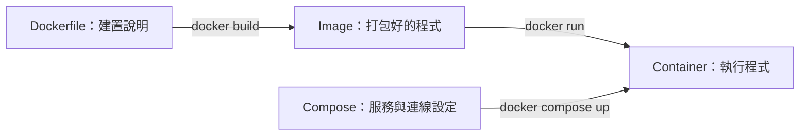
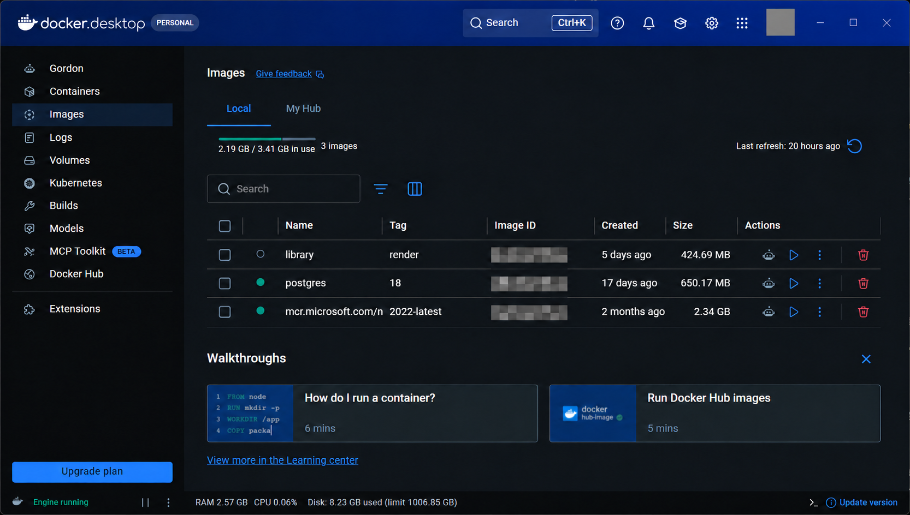
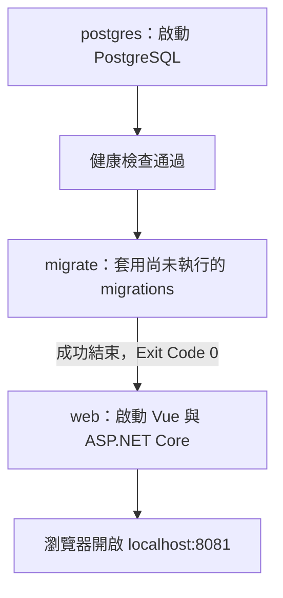
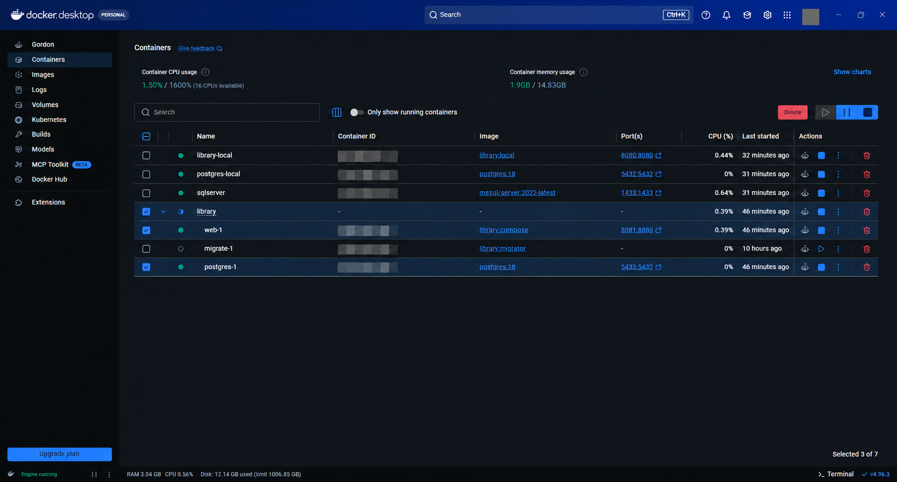
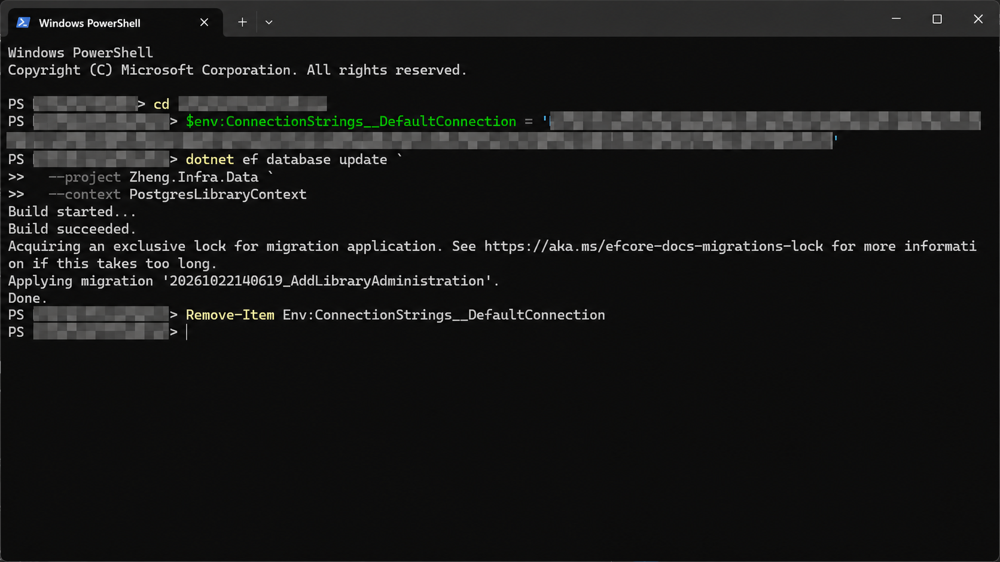

專案裡已經有 Dockerfile，為什麼 Docker Desktop 的 Containers 還看不到網站？執行 `docker build` 後，映像到底放在哪裡？改用 Compose 之後，多出一個執行完就停止的 `migrate`，它又是在做什麼？

這篇以 Library 圖書管理系統的實作過程，整理從建置映像、啟動網站，到一次啟動 PostgreSQL 與資料庫更新服務的流程。最後完成的本機環境，會先準備資料庫、套用專案的 migrations，再提供 Vue 前端與 ASP.NET Core API。

本文使用 Windows、PowerShell、Docker Desktop 的 Linux containers、.NET 8、EF Core 9 與 PostgreSQL 18。圖片以實際操作截圖經影像工具遮蔽個資後製作，作為介面位置示意；帳號頭像、識別碼、個人路徑及連線憑證已遮蔽，設定值請以文字範例為準。

如果還沒建立過 PostgreSQL 容器，可先閱讀 [Windows 用 Docker 建立 PostgreSQL：DBeaver 連線與 EF Core 建表實作]()。本文著重網站容器與 Compose 的整合。

## 1. Dockerfile、Image、Container 與 Compose 分別是什麼？

| 名稱 | 負責的事情 | 在本例中的樣子 |
|---|---|---|
| Dockerfile | 描述如何建置程式與執行環境 | 編譯 Vue、發佈 ASP.NET Core |
| Image（映像） | 建置完成的程式與執行環境 | `library:local`、`library:compose` |
| Container（容器） | 使用某個映像建立的執行個體，可啟動或停止 | `library-local`、`library-web-1` |
| Compose 設定檔 | 描述服務、映像、連接埠、環境變數與儲存卷 | `docker-compose.yml` |



同一個 Image 可以建立多個容器。Image 的標籤可以自行取名，例如 `local`、`render`；名稱叫 `library:render`，不表示它已經部署到 Render。映像仍可在自己的 Docker Desktop 執行。

## 2. 先用 Dockerfile 建置 Image

開啟 Docker Desktop，等待 Engine 啟動，再於 PowerShell 進入專案根目錄。以下路徑請換成自己的位置：

```powershell
cd D:\Projects\Library
docker build -t library:local .
```

| 指令部分 | 意思 |
|---|---|
| `docker build` | 建置映像 |
| `-t library:local` | 指定映像名稱 `library` 與標籤 `local` |
| 最後的 `.` | 目前資料夾是建置來源，預設讀取其中的 Dockerfile |

Dockerfile 會依步驟取得依賴、編譯與打包。本例先用 Node 建置 Vue，再用 .NET SDK 發佈後端，最後將前端靜態檔放進後端的 `wwwroot`，由一個網站容器提供前後端內容。[Dockerfile 官方說明](https://docs.docker.com/build/concepts/dockerfile/)

建置成功後，在 **Docker Desktop → Images → Local** 可以看到映像；網站要在建立並啟動容器後才會提供服務。



圖中是先前已有的 `library:render`。執行本文的建置命令，則會產生 `library:local` 這個標籤。

### Image 存在哪裡？

Image 由 Docker Desktop 管理，不會在專案資料夾出現一個同名的 `.exe`。Windows 使用 WSL 2 後端時，Docker 資料通常位於它管理的虛擬磁碟；本次環境的資料磁碟在 `%LOCALAPPDATA%\Docker\wsl\disk\docker_data.vhdx`，其他安裝或自訂儲存位置可能不同。

這個 `.vhdx` 是虛擬硬碟檔，日常操作從 Docker Desktop 的 Images、Containers、Volumes 進行即可。如果要匯出可攜帶的映像檔，可使用：

```powershell
docker save -o library-local.tar library:local
```

這會匯出映像；資料庫 volume 裡的資料需要另外備份，不包含在這份映像封裝中。[映像匯出文件](https://docs.docker.com/reference/cli/docker/image/save/)

## 3. `docker run` 會把 Image 變成可執行的容器

在導入 Compose 前，我先用一個網站容器連接既有的 `postgres-local`。下面是這種做法的設定形式；請先將兩個佔位值換成自己的資料庫密碼與至少 32 bytes 的隨機 JWT 金鑰。

這裡假設 `postgres-local` 已依前篇文章完成資料表建立；單獨啟動網站容器不會自動套用 migrations。

```powershell
docker start postgres-local

docker run -d --name library-local `
  -p 127.0.0.1:8080:8080 `
  -e "Database__Provider=PostgreSql" `
  -e "ConnectionStrings__DefaultConnection=Host=host.docker.internal;Port=5432;Database=library;Username=dev;Password=<本機資料庫密碼>" `
  -e "JWT__KEY=<至少32bytes的隨機金鑰>" `
  -e "FrontendBaseUrl=http://localhost:8080" `
  library:local
```

這一節是手動啟動方式的對照；如果只要完成下文的 Compose 環境，可直接從第 4 節開始。

| 設定 | 用途 |
|---|---|
| `-d` | 在背景執行 |
| `--name library-local` | 指定容器名稱 |
| `127.0.0.1:8080:8080` | 只對本機開放主機的 8080，轉送至容器的 8080 |
| `-e` | 傳入環境變數 |
| `host.docker.internal` | 在 Docker Desktop 容器內連回主機 |
| `JWT__KEY` | 本專案簽署與驗證登入 Token 的金鑰 |
| `FrontendBaseUrl` | 後端產生密碼重設等連結時使用的網站網址 |

PowerShell 每行末尾的反引號表示指令尚未結束，後面不要再加空白。`ConnectionStrings__DefaultConnection` 中的雙底線，是 .NET 設定階層分隔的寫法。

建立完成後，可開啟 `http://localhost:8080`。平常停止、啟動既有容器，使用 `docker stop library-local` 與 `docker start library-local`；再次執行同名 `docker run`，會因容器名稱已存在而失敗。

映像、啟動設定與資料庫都要配合，這也是下一步改用 Compose 的原因。[Docker run 文件](https://docs.docker.com/reference/cli/docker/container/run/)

## 4. 將網站、資料庫與 Migration 整理成 Compose

`docker-compose.yml` 通常由開發者建立，將啟動設定保存成 YAML。`compose.yaml` 也是支援的檔名；本文使用 `docker-compose.yml`，操作指令是 `docker compose`。

這次建立三個服務：



範本適用於本文既有的 Library 專案，包含 `Zheng.Infra.Data`、`PostgresLibraryContext`、前端專案與 PostgreSQL migrations。套用到其他 .NET 專案時，需要調整專案路徑、context 和設定名稱。

完整檔案可下載：[Dockerfile](examples/Dockerfile)、[docker-compose.yml](examples/docker-compose.yml)、[環境變數範本](examples/env.example)、[Docker 建置排除範本](examples/dockerignore.example)。請將後兩個範本分別存為 `.env.example`、`.dockerignore`，與 Dockerfile 和 Compose 檔案放在專案根目錄。

### Dockerfile 多一個 `migrator` 建置目標

完整 Dockerfile 除了前端、後端與網站執行環境，還會把 migrations 打包成 `efbundle`：

```dockerfile
FROM backend AS migration-build
RUN dotnet tool install --tool-path /tools dotnet-ef --version 9.0.6
RUN mkdir -p /migrations && /tools/dotnet-ef migrations bundle \
    --project Zheng.Infra.Data/Zheng.Infra.Data.csproj \
    --context PostgresLibraryContext --configuration Release \
    --output /migrations/efbundle

FROM mcr.microsoft.com/dotnet/aspnet:8.0 AS migrator
WORKDIR /app
COPY --from=migration-build /migrations/efbundle ./
USER $APP_UID
ENTRYPOINT ["./efbundle"]
```

這段是完整 Dockerfile 的節錄，依賴前面的 `backend` stage。`migrator` 是建置目標的名稱；`efbundle` 才是啟動後實際執行的 EF Core 更新程式。建置 bundle 時不會連線更新資料庫，執行 bundle 時才會使用指定的連線。

本專案的 `PostgresLibraryContextFactory` 直接讀取 `ConnectionStrings__DefaultConnection` 環境變數，因此更新工具不用啟動 Web API，也不依賴 Web 專案的 appsettings。這是專案本身的設計。

### 完整 `docker-compose.yml`

```yaml
name: library

services:
  postgres:
    image: postgres:18
    restart: unless-stopped
    environment:
      POSTGRES_DB: ${POSTGRES_DB:-library}
      POSTGRES_USER: ${POSTGRES_USER:-library}
      POSTGRES_PASSWORD: ${POSTGRES_PASSWORD:?Set POSTGRES_PASSWORD in .env}
    ports:
      - "127.0.0.1:${POSTGRES_PORT:-5433}:5432"
    volumes:
      - postgres-data:/var/lib/postgresql
    healthcheck:
      test: ["CMD-SHELL", "pg_isready -h 127.0.0.1 -U \"$$POSTGRES_USER\" -d \"$$POSTGRES_DB\""]
      interval: 5s
      timeout: 5s
      retries: 12
      start_period: 10s

  migrate:
    image: library:migrator
    build:
      context: .
      target: migrator
    restart: "no"
    environment:
      ConnectionStrings__DefaultConnection: "Host=postgres;Port=5432;Database=${POSTGRES_DB:-library};Username=${POSTGRES_USER:-library};Password=${POSTGRES_PASSWORD:?Set POSTGRES_PASSWORD in .env}"
    depends_on:
      postgres:
        condition: service_healthy

  web:
    image: library:compose
    build:
      context: .
      target: runtime
    restart: unless-stopped
    environment:
      ASPNETCORE_ENVIRONMENT: Production
      Database__Provider: PostgreSql
      ConnectionStrings__DefaultConnection: "Host=postgres;Port=5432;Database=${POSTGRES_DB:-library};Username=${POSTGRES_USER:-library};Password=${POSTGRES_PASSWORD:?Set POSTGRES_PASSWORD in .env}"
      JWT__KEY: ${JWT_KEY:?Set JWT_KEY in .env to at least 32 bytes}
      FrontendBaseUrl: "http://localhost:${APP_PORT:-8081}"
    ports:
      - "127.0.0.1:${APP_PORT:-8081}:8080"
    volumes:
      - uploads:/app/wwwroot/uploads
      - data-protection:/home/app/.aspnet/DataProtection-Keys
    depends_on:
      postgres:
        condition: service_healthy
      migrate:
        condition: service_completed_successfully

volumes:
  postgres-data:
  uploads:
  data-protection:
```

`service_healthy` 讓更新程式等 PostgreSQL 可接受連線；`service_completed_successfully` 讓網站等資料庫更新成功。只有一般的啟動先後順序，還不足以保證資料庫已可用。[Compose 啟動順序文件](https://docs.docker.com/compose/how-tos/startup-order/)

本例使用 PostgreSQL 18，資料 volume 掛載 `/var/lib/postgresql`，其預設資料目錄位於 `/var/lib/postgresql/18/docker`。不要直接套用舊版本教學的掛載位置。[PostgreSQL 官方映像文件](https://hub.docker.com/_/postgres#pgdata)

## 5. 準備 `.env`，一次啟動整個環境

環境範本 `.env.example` 的主要欄位如下：

```dotenv
APP_PORT=8081
POSTGRES_PORT=5433
POSTGRES_DB=library
POSTGRES_USER=library
POSTGRES_PASSWORD=
JWT_KEY=
```

以下 PowerShell 會在 `.env` 尚不存在時，從範本產生兩組隨機值；不必先手動複製範本。若已有 `.env`，請保留原本使用的密碼與金鑰。

```powershell
if (-not (Test-Path .env)) {
    $composeRng = [System.Security.Cryptography.RandomNumberGenerator]::Create()
    try {
        $composeBytes = New-Object byte[] 32
        $composeRng.GetBytes($composeBytes)
        $composePassword = [BitConverter]::ToString($composeBytes).Replace('-', '').ToLowerInvariant()
        $composeRng.GetBytes($composeBytes)
        $composeJwt = [BitConverter]::ToString($composeBytes).Replace('-', '').ToLowerInvariant()
        Get-Content .env.example |
            ForEach-Object {
                $_ -replace '^POSTGRES_PASSWORD=$', "POSTGRES_PASSWORD=$composePassword" `
                   -replace '^JWT_KEY=$', "JWT_KEY=$composeJwt"
            } | Set-Content .env -Encoding ascii
    } finally {
        $composeRng.Dispose()
    }
}
```

隨機值採用十六進位字元，避免密碼中的分號、引號或 `$` 與連線字串、Compose 變數語法衝突。真實 `.env` 放在本機，`.gitignore` 加入 `/.env`；`.dockerignore` 也要排除 `.env`、含密鑰的 appsettings、開發憑證與本機上傳檔案。本文下載範本只保留不含密鑰的 Production 設定檔進入建置。

在同一個專案資料夾執行：

```powershell
# 驗證設定，避免把展開後的密碼印出來
docker compose config --quiet

# 建置並在背景啟動
docker compose up -d --build

# 查看所有服務，包含執行完就結束的 migrate
docker compose ps -a
```

完成後開啟 `http://localhost:8081`，Docker Desktop 的 Containers 會出現可展開的 `library` 群組。



| 服務 | 正常狀態 | 用途 |
|---|---|---|
| `postgres` | Running / Healthy | 保存資料與執行 SQL |
| `migrate` | Exited (0) | 本次資料庫更新已成功完成 |
| `web` | Running | 提供 Vue 網站與 ASP.NET Core API |

`migrate` 完成工作就結束，所以三個服務不需要一直全部亮綠燈。若它以非零代碼結束，才需要查看 `docker compose logs migrate`；依目前設定，更新失敗時網站不會在這次 Compose 啟動流程中接著啟動。

Library 的 migrations 包含角色、管理員與 50 本示範書，這是本專案提供的資料，不是 PostgreSQL 或 EF Core 自動附送。專案預設示範登入為 `admin`／`Admin@123`，對外提供服務前應變更密碼。SMTP 與社群登入仍需要另外設定。

## 6. 兩個都叫 library，到底連到哪一個？

這次保留了先前手動建立的環境，同時建立一套獨立的 Compose 環境，因此 Docker Desktop 會看到兩組 PostgreSQL。它們資料庫名稱都叫 `library`，但屬於不同的 PostgreSQL 執行個體，資料各自保存。

| 環境 | 網站容器與網址 | 資料庫容器 | Windows／DBeaver 連線 | 資料庫帳號 |
|---|---|---|---|---|
| 手動建立 | `library-local`，`localhost:8080` | `postgres-local` | `localhost:5432`，DB `library` | `dev` |
| Compose | `library-web-1`，`localhost:8081` | `library-postgres-1` | `localhost:5433`，DB `library` | `library` |

Docker Desktop 在群組內可能簡寫為 `web-1`、`postgres-1`。以本文預設的專案名稱與服務設定，完整名稱帶有 `library-` 前綴。

### 從哪裡連線，決定 Host 與 Port

| 執行位置 | 目標是 Compose 資料庫時的連線 |
|---|---|
| Windows 上的 DBeaver 或 `dotnet ef` | `Host=localhost;Port=5433` |
| 同一組 Compose 的 `web`／`migrate` | `Host=postgres;Port=5432` |

`postgres` 是 Compose 的服務名稱，可在它建立的網路中解析。`5433:5432` 的左側是主機埠，右側是資料庫容器內的埠；因此容器之間仍連 5432。[Compose 網路說明](https://docs.docker.com/compose/how-tos/networking/)

### 密碼在哪裡看？

Compose 環境使用專案根目錄 `.env` 的 `POSTGRES_PASSWORD`。也可以在 Docker Desktop 開啟 `library-postgres-1`，進入 **Inspect → Env**，找到 `POSTGRES_PASSWORD=...`；實際按鈕排列可能隨 Docker Desktop 版本不同。

這是容器建立時設定的初始化密碼。如果之後曾用 SQL 修改資料庫帳號密碼，或只改了 `.env`，這些顯示值不一定等於資料庫目前接受的密碼。PostgreSQL 的初始化環境變數主要作用於空白資料目錄，重用已有 volume 不會自動改密碼或重建資料庫。

分享 Env 頁面或 PowerShell 畫面時，應遮蔽密碼、JWT 金鑰、完整雲端連線資訊和個人路徑。本文僅附上已遮蔽的操作示意。

## 7. Migration 是更新資料庫，還是重建一個？

本例由 `postgres` 服務在首次初始化空白資料卷時建立資料庫，再由 `migrate` 建立或更新資料表。之後再次執行更新工具，會根據遷移紀錄，只套用尚未執行的 migrations。

| 資料庫狀態 | 本例的處理方式 |
|---|---|
| 新資料庫，尚無資料表 | 從第一筆 migration 建立結構與專案種子資料 |
| 已有部分 migration | 套用後續尚未執行的變更 |
| 已套用目前所有 migration | 回報已是最新狀態，不重複匯入示範書 |

本專案的紀錄表叫 `__LibraryPostgresMigrationsHistory`。Migration 的實際效果取決於程式內容，也可能刪欄位或轉換資料，因此更新前仍要檢查變更；它不是每次刪掉整個資料庫再重新建立。[EF Core 套用遷移文件](https://learn.microsoft.com/en-us/ef/core/managing-schemas/migrations/applying)

例如，假設要加入副標題欄位，Migration 的 C# 寫法可以是：

```csharp
migrationBuilder.AddColumn<string>(
    name: "Subtitle",
    table: "Book",
    type: "text",
    nullable: true);
```

對應的 PostgreSQL 結構變更類似：

```sql
ALTER TABLE "Book" ADD COLUMN "Subtitle" text;
```

這是語法示意。Migration 的 C# 放在專案裡，SQL 由資料庫工具執行；PowerShell 則用來執行下一節的更新命令。

## 8. 在 PowerShell 套用最新的 Migration

### 更新 Compose 的資料庫

在有 `docker-compose.yml` 與 `.env` 的專案根目錄執行：

```powershell
docker compose run --rm --build migrate
```

`--build` 先建置最新的更新工具，`run` 啟動一次性更新容器，`--rm` 在它結束後移除該臨時容器。連線依照 Compose 設定指向 `postgres:5432`，也就是從 Windows 以 5433 連線的那套資料庫。[Compose run 文件](https://docs.docker.com/reference/cli/docker/compose/run/)

若網站程式也有更新，使用：

```powershell
docker compose up -d --build
```

### 更新舊的 `postgres-local`

如果要更新的是網站 `localhost:8080` 使用的資料庫，可從 Windows 直接執行 EF Core 工具。前提是本機已有 .NET SDK 與相容的 `dotnet-ef`；密碼請使用原本 `postgres-local` 的設定。

```powershell
cd D:\Projects\Library
docker start postgres-local

$env:ConnectionStrings__DefaultConnection = 'Host=localhost;Port=5432;Database=library;Username=dev;Password=<原本本機資料庫密碼>'

try {
    dotnet ef database update `
      --project Zheng.Infra.Data `
      --context PostgresLibraryContext
    if ($LASTEXITCODE -ne 0) { throw '資料庫更新失敗，請查看上方錯誤。' }
} finally {
    Remove-Item Env:ConnectionStrings__DefaultConnection -ErrorAction SilentlyContinue
}
```

這裡使用 `localhost`，是因為 `dotnet ef` 在 Windows 主機執行。`--project` 指向 migrations 所在專案，`--context` 選擇 PostgreSQL 專用的 context。不要把這條 5432 的連線誤認為 Compose 的 5433。



這次實際更新時顯示：

```text
Build succeeded.
Applying migration '20261022140619_AddLibraryAdministration'.
Done.
```

表示新增的 migration 已成功套用。若顯示 `The database is already up to date.`，則表示目標資料庫已套用目前工具中全部的 migrations。

`Remove-Item Env:ConnectionStrings__DefaultConnection` 只清除目前 PowerShell 程序的連線環境變數，不會刪除資料庫，也不會清除終端機歷史紀錄。

### 修改模型之後，還需要產生 Migration

`database update` 和 `efbundle` 都是套用已存在的 migrations。若真的修改了 C# 資料模型，開發階段先產生並檢查新的遷移檔，再重建更新工具：

```powershell
# 僅在已修改資料模型、需要建立新遷移時執行；名稱請依實際變更調整
dotnet ef migrations add AddBookSubtitle `
  --project Zheng.Infra.Data `
  --context PostgresLibraryContext `
  --output-dir Migrations/PostgreSql

# 檢查新增的 migration 內容後，更新 Compose 環境
docker compose up -d --build
```

若專案同時支援 SQL Server，還需要依專案流程維護它自己的 context 與 migrations；兩套 provider 的遷移不可直接混用。

## 9. 保存資料與日常操作

本例有三個 named volumes：

| Volume | 保存內容 |
|---|---|
| `library_postgres-data` | PostgreSQL 資料 |
| `library_uploads` | 使用者上傳檔案 |
| `library_data-protection` | ASP.NET Core Data Protection 金鑰 |

網站映像預先建立可供容器使用者寫入的掛載目錄。Data Protection 金鑰和 `.env` 裡的 JWT 簽署金鑰用途不同，這裡分別保存。正式環境還需要依部署方式規劃金鑰保護與資料備份。

```powershell
# 啟動既有環境
docker compose up -d

# 查看網站與資料庫更新記錄
docker compose logs --tail 100 web migrate

# 停止服務，保留容器與資料
docker compose stop

# 程式或 migrations 更新後，建置並更新容器
docker compose up -d --build

# 移除本組容器與網路，保留 named volumes
docker compose down
```

`docker compose down -v` 會連同本例的 named volumes 一起刪除，包含資料庫與上傳檔案；一般停止或更新不需要這個參數。

另外，`docker build` 完成後，已在執行的容器仍使用建立時的映像。單純按 Restart 不會換成剛建置的程式，也不會套用新的環境變數；Compose 環境使用 `up -d --build` 完成建置與必要的容器重建。[Compose up 文件](https://docs.docker.com/reference/cli/docker/compose/up/)、[restart 文件](https://docs.docker.com/reference/cli/docker/compose/restart/)

## 10. 這次如何確認環境可用？

本次實際驗證了首頁與書封 HTTP 200、管理員登入，以及書籍 API 回傳 50 本示範書；接著移除並重建這組 Compose 容器，確認資料仍保留，更新工具回報資料庫已是最新狀態。

在 DBeaver 連到 Compose 的 `localhost:5433`，也可以檢查：

```sql
SELECT current_database();

SELECT "MigrationId"
FROM "__LibraryPostgresMigrationsHistory"
ORDER BY "MigrationId";

SELECT COUNT(*) AS book_count FROM "Book";
```

本文版本預期可看到三筆 migrations 與 50 本示範書；後續專案更新或新增書目後，數量會跟著改變。這些檢查比只確認容器亮綠燈更能反映網站與資料庫是否配合運作。

若接著要將網站部署到雲端，可以延伸閱讀 [Render＋Supabase：用 Docker 部署 ASP.NET Core＋Vue 網站]()，處理雲端資料庫、TLS 憑證與正式網站設定。
