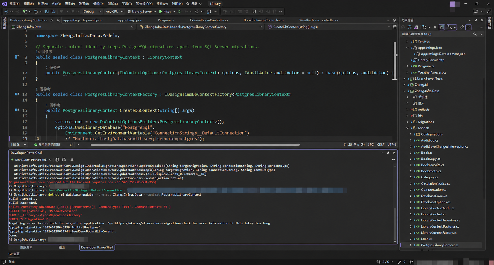
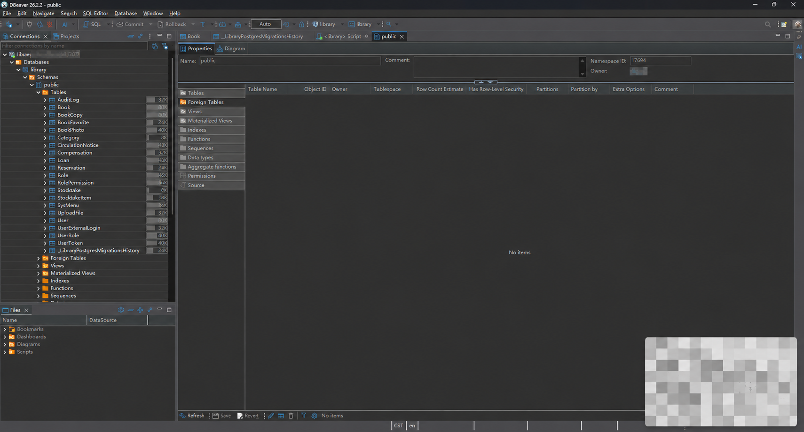

原本使用 SQL Server 的 .NET 專案，要在自己的電腦試用 PostgreSQL，可以用 Docker 啟動資料庫，再用 DBeaver 查看資料。這篇記錄實際操作過程，包含第一次執行 migration 時遇到的「沒有提供密碼」問題。

本文以 Windows、PowerShell、PostgreSQL 18 與既有 Library 專案為例。截圖中的連線字串、個人路徑與帳號資訊已遮蔽；指令中的密碼是範例，請自行替換。

## 1. 先分清楚各個工具

| 工具 | 負責的工作 |
| --- | --- |
| Docker Desktop | 執行 PostgreSQL 容器 |
| PostgreSQL | 儲存資料與執行 SQL |
| DBeaver CE | 連線、查看資料表與執行查詢的圖形管理工具 |
| EF Core migration | 根據專案的遷移檔案建立、更新資料庫結構 |

有 Docker 就不必另外在 Windows 安裝 PostgreSQL 伺服器。DBeaver 是操作介面，安裝它不等於安裝資料庫。

## 2. 用 Docker 啟動 PostgreSQL

先啟動 Docker Desktop，等待 Engine 正常運作，再開啟 PowerShell。將下面的範例密碼換成自己的本機開發密碼，後續步驟都使用同一組。

```powershell
docker run --name postgres-local `
  -e POSTGRES_USER=dev `
  -e POSTGRES_PASSWORD=ChangeThisLocalPassword `
  -e POSTGRES_DB=library `
  -p 127.0.0.1:5432:5432 `
  -v postgres_data:/var/lib/postgresql `
  -d postgres:18
```

PowerShell 的反引號表示換行後繼續同一條指令，反引號後不要加空白。

| 參數 | 說明 |
| --- | --- |
| `--name postgres-local` | 容器名稱 |
| `POSTGRES_USER` | 初始化帳號 |
| `POSTGRES_PASSWORD` | 初始化密碼 |
| `POSTGRES_DB` | 初始化資料庫名稱 |
| `127.0.0.1:5432:5432` | 只對本機開放 5432 連接埠 |
| `postgres_data` | 保存資料的 Docker named volume |

本文使用 PostgreSQL 18 的 `/var/lib/postgresql` 掛載方式，其他主要版本請查閱對應映像文件。可參考 [Docker 官方 PostgreSQL 持久化教學](https://docs.docker.com/guides/postgresql/immediate-setup-and-data-persistence/)。

第一次建立後，平常只需停止與啟動，不必重複 `docker run`：

```powershell
docker stop postgres-local
docker start postgres-local
docker ps
```

SQL Server 的 1433 和 PostgreSQL 的 5432 可以同時使用。如果本機 5432 已被占用，可將映射改成 `127.0.0.1:5433:5432`，DBeaver 與程式連線也要改用 5433。

注意：`POSTGRES_*` 初始化設定主要作用於空白資料目錄。已有 volume 時，改環境變數不會自動修改既有帳密或重建資料庫，詳見 [PostgreSQL 官方映像說明](https://hub.docker.com/_/postgres)。

## 3. 用 DBeaver 連線

安裝 DBeaver CE（Community Edition）後，第一次啟動的 `Create sample database` 可以不勾選，這是 SQLite 示範資料庫，與這次的 PostgreSQL 無關；每日提示依個人喜好選擇。

新增資料庫連線，選擇 **PostgreSQL**，填入：

| 欄位 | 設定 |
| --- | --- |
| Host | `localhost` |
| Port | `5432` |
| Database | `library` |
| Username | `dev` |
| Password | 建立容器時設定的密碼 |

按 **Test Connection**。第一次若要求下載 JDBC 驅動程式，允許下載；看到 `Connected` 後，按 **OK → Finish** 儲存連線。

`library` 和 `postgres` 是資料庫名稱，PostgreSQL 是資料庫系統。連到 `library` 就已經在使用 PostgreSQL，不需要為了「切到 PostgreSQL」改連 `postgres`。

## 4. .NET 專案切換資料庫設定

這次的 Library 專案已經具備 SQL Server／PostgreSQL 雙 provider 支援，因此可以透過設定切換。**一般專案不能只修改連線字串就完成轉換**，還需要 Npgsql EF Core provider、`UseNpgsql` 設定，以及 PostgreSQL 專用 migrations；套件版本需配合專案的 EF Core 版本。

本機 `appsettings.Development.json` 的設定形式如下，合併到既有 JSON，不要覆蓋其他區塊：

```json
{
  "Database": {
    "Provider": "PostgreSql"
  },
  "ConnectionStrings": {
    "DefaultConnection": "Host=localhost;Port=5432;Database=library;Username=dev;Password=ChangeThisLocalPassword"
  }
}
```

`Database:Provider` 是本專案定義的切換設定，不是所有 .NET 專案內建的選項。真實密碼請以環境變數或 user-secrets 提供，不要提交到公開 Git repository。若已有環境變數或 user-secrets，注意它們可能覆寫 JSON 的值。

EF Core 的 migration 具有 provider 差異。這個專案以 `PostgresLibraryContext` 管理 PostgreSQL 的 migrations，與 SQL Server 分開，不能直接拿 SQL Server 的遷移套用到 PostgreSQL。可參考 [EF Core 多資料庫 provider 遷移文件](https://learn.microsoft.com/en-us/ef/core/managing-schemas/migrations/providers)。

## 5. 設定 PowerShell 環境變數

在專案根目錄開啟 PowerShell，Visual Studio 內的 **Developer PowerShell** 也可以。路徑請換成自己的位置：

```powershell
cd D:\Projects\Library

$env:ConnectionStrings__DefaultConnection = 'Host=localhost;Port=5432;Database=library;Username=dev;Password=ChangeThisLocalPassword'
```

這是一行 PowerShell，不是 SQL，也不是 Ruby。

| 寫法 | 意思 |
| --- | --- |
| `$env:` | 讀取或設定目前程序的環境變數 |
| `ConnectionStrings` | 設定區塊名稱 |
| `__` | .NET 環境變數設定中的階層分隔符號 |
| `DefaultConnection` | 連線字串名稱 |

在 .NET 設定系統中，`ConnectionStrings__DefaultConnection` 對應到 `ConnectionStrings:DefaultConnection`。雙底線的映射規則可參考 [ASP.NET Core 設定文件](https://learn.microsoft.com/en-us/aspnet/core/fundamentals/configuration/)。

這裡特別要設定，是因為本專案的 `PostgresLibraryContextFactory` 直接使用 `Environment.GetEnvironmentVariable` 取得連線字串，不會自動載入 API 的 `appsettings.Development.json`。這是此 factory 的實作方式，不代表所有 EF Core 專案都必須這樣操作。

設定只作用於目前 PowerShell 與從它啟動的子程序。另一個終端機、已開啟的 Visual Studio，不會因此自動取得相同的值。

## 6. 執行 migration 建立資料表

在**剛才設定環境變數的同一個 PowerShell** 執行：

```powershell
dotnet ef database update --project Zheng.Infra.Data --context PostgresLibraryContext
```

`--project` 指定 migrations 所在的專案，`--context` 指定使用 PostgreSQL context。本文假設專案已包含遷移檔案，且已安裝與專案相容的 `dotnet-ef` 工具。

完成時會看到類似訊息：

```text
Build succeeded.
Applying migration '20261018042136_InitialPostgres'.
Applying migration '20261018051744_SeedDemoBooksWithCovers'.
Done.
```



此專案的初始 migration 建立資料表、角色、選單與管理員資料，接著加入 50 本示範書。其他專案會依自己的 migration 內容建立資料，不一定有這些種子資料。公開使用前應更換預設管理員密碼。

### 遇到 No password has been provided

```text
No password has been provided but the backend requires one
```

這表示連線未提供密碼。這次是直接執行 migration，卻沒有在目前 PowerShell 設定連線環境變數，factory 因而使用不含密碼的預設值。

回到同一個視窗，先執行上一節的環境變數設定，再重新執行 `dotnet ef database update`。不要只在另一個 PowerShell 視窗設定。

### 中間有紅字，但最後顯示 Done

這次首次執行時，查詢 `__LibraryPostgresMigrationsHistory` 的指令曾顯示失敗，之後 EF Core 繼續建立並套用兩筆 migrations，最後顯示 `Done.`。

這個案例是空白資料庫尚無遷移紀錄表，不能推論所有紅字都可以忽略。應同時檢查最後結果與實際資料表；若以例外結束，就要依錯誤內容處理。

## 7. 在 DBeaver 確認結果

選取連線按 **F5** 重新整理，展開：

```text
library（連線）
└─ Databases
   └─ library
      └─ Schemas
         └─ public
            └─ Tables
```

會看到 `Book`、`User`、`Loan` 等資料表。對 `Book` 按右鍵，選 **View Data → All Rows**，即可查看書籍資料。



若要用 SQL 確認，在此連線新增 SQL Script，選取查詢按 **Ctrl + Enter** 執行：

```sql
SELECT current_database();
SELECT COUNT(*) AS book_count FROM public."Book";
SELECT * FROM public."__LibraryPostgresMigrationsHistory";
```

本專案的表名含大寫字母，手寫 PostgreSQL SQL 時使用雙引號保留大小寫。預期資料庫為 `library`，示範書數量為 50，遷移紀錄有兩筆。若停留在 `public` 的屬性頁看到 `No items`，請直接開啟資料表的 Data 頁確認，不要只用屬性頁判斷資料是否存在。

## 8. 清除環境變數，不等於清除資料庫

操作完成後，若不希望此視窗繼續覆寫連線設定：

```powershell
Remove-Item Env:ConnectionStrings__DefaultConnection -ErrorAction SilentlyContinue
```

查看是否還有設定：

```powershell
$env:ConnectionStrings__DefaultConnection
```

沒有輸出表示已移除。關閉該 PowerShell 也會結束這次的程序環境設定。這不會刪除 PostgreSQL 資料、修改 JSON，或移除其他地方的持久環境變數。

## 9. 練習重新建表：重設 public schema

**以下操作會刪除目標資料庫 `public` 裡的資料表、資料及依賴物件，也會移除本專案的 migration 紀錄。只適用於可以丟棄的本機練習資料庫。** 先停止後端，避免背景服務在重設期間存取資料庫。

在 DBeaver 執行以下查詢，先確認目前連到的是可刪除的 `library`：

```sql
SELECT current_database(), current_user;
```

確認目標後，再選取並執行下面兩行。`dev` 是本文建立的帳號，如果使用其他 owner，請改成自己的帳號：

```sql
DROP SCHEMA public CASCADE;
CREATE SCHEMA public AUTHORIZATION dev;
```

若 DBeaver 使用手動交易模式，確認成功後要 Commit。重新整理後，再按照第 5、6 節設定連線並執行 migration，資料表和種子資料就會重新建立。這是刪除整個 schema 後重建，和「保留表格，只刪除資料列」不同。

## 10. 平常開發的操作順序

1. 啟動 Docker Desktop，確認 `postgres-local` 正在執行。
2. 有新的 PostgreSQL migration 時，設定連線環境變數後執行 `database update`。
3. 以 Development 環境啟動後端，確認 provider 和連線字串一致。
4. 用 DBeaver 查看資料或執行查詢。

這套流程建立的是 PostgreSQL 的結構與種子資料。原本 SQL Server 裡的使用者、借閱紀錄及其他既有資料不會自動搬過來，正式資料搬遷需要另外規劃匯出、轉換與驗證。
