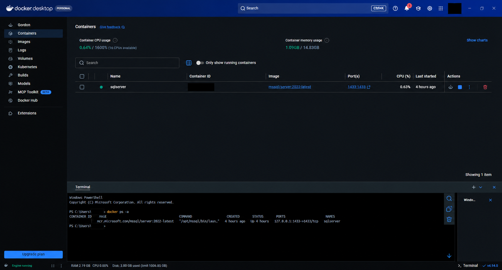
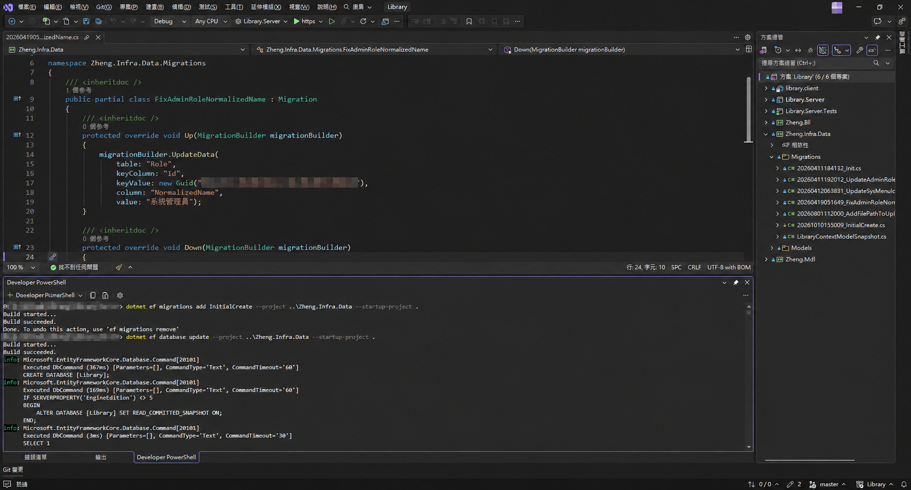

在 Windows 開發 .NET 專案時，可以把 SQL Server 放在 Docker 容器中，再透過 SSMS 管理資料庫。資料表則交給 EF Core Code First，從 C# 模型與遷移檔案建立。

這篇整理實際操作流程，以及容易遇到的連線錯誤、工具版本衝突和多專案遷移問題。所有指令都在 Windows PowerShell 執行，除非另有說明。

## 1. 先分清楚三個工具

| 工具 | 用途 |
| --- | --- |
| SQL Server | 儲存資料、執行 SQL 的資料庫伺服器，本文放在 Docker 容器內 |
| SSMS | 安裝在 Windows 的管理工具，用來連線、查詢和查看資料表 |
| EF Core | 在 .NET 專案中將 C# 模型對應到資料庫，並透過遷移更新結構 |

Docker 要下載的是 SQL Server 映像檔。SSMS 另外從 [微軟官方頁面](https://learn.microsoft.com/en-us/ssms/download-sql-server-management-studio-ssms/) 安裝。

開始前，準備好 Docker Desktop、.NET SDK 與 SSMS。Docker Desktop 使用 Linux containers。本文的新專案範例採用 .NET 8 與 EF Core 8；既有專案則以它原本使用的 EF Core 版本為準。

## 2. 在 Windows 安裝 Docker Desktop

本文以 Intel／AMD 的 Windows 11 電腦與 WSL 2 後端為例。先在工作管理員的「效能 → CPU」確認「虛擬化」已啟用；若未啟用，需在 BIOS／UEFI 開啟 CPU 虛擬化功能。Windows 版本與硬體需求以 [Docker 官方安裝文件](https://docs.docker.com/desktop/setup/install/windows-install/) 為準。

### 安裝或更新 WSL 2

以系統管理員身分開啟 PowerShell。尚未安裝 WSL 時執行：

```powershell
wsl --install
```

依提示重新啟動電腦。如果出現 Ubuntu 首次設定畫面，依提示建立 Linux 使用者名稱與密碼；它們與 Windows 帳號、SQL Server 帳密無關。

已安裝 WSL 的電腦，或重新啟動後，執行：

```powershell
wsl --update
wsl --set-default-version 2
wsl --version
wsl --list --verbose
```

`wsl --list --verbose` 會列出已安裝的 Linux 發行版與版本；若要把既有 WSL 1 發行版轉為 WSL 2，可使用 `wsl --set-version 發行版名稱 2`。設定預設版本只影響之後安裝的發行版。WSL 操作細節可參考 [微軟 WSL 設定文件](https://learn.microsoft.com/en-us/windows/wsl/setup/environment)。

### 下載與啟動 Docker Desktop

1. 開啟 [Docker Desktop for Windows 官方下載頁](https://docs.docker.com/desktop/setup/install/windows-install/)，Intel／AMD 電腦選擇 x86_64 版本。
2. 執行安裝程式，依提示完成安裝；若有後端選項，選擇 WSL 2。
3. 若安裝程式要求重新啟動或登出，先完成該步驟。
4. 從開始功能表開啟 Docker Desktop，完成首次啟動設定與條款確認。
5. 在「Settings → General」確認使用 WSL 2 engine；不同版本或安裝模式可能已固定使用此後端。
6. 確認目前使用 Linux containers，等待 Docker Engine 啟動完成。

若 Docker Desktop 選單顯示「Switch to Linux containers」，點選切換；若顯示「Switch to Windows containers」，代表目前已使用 Linux containers。本文的 SQL Server 映像檔需要 Linux 容器模式。

只在 Windows PowerShell 操作 Docker 時，不需要額外在 Ubuntu 內安裝 Docker Engine。若要從自己的 WSL 發行版使用 Docker，可再到「Settings → Resources → WSL Integration」啟用對應發行版。參考 [Docker WSL 2 後端說明](https://docs.docker.com/desktop/features/wsl/)。

### 驗證安裝

重新開啟 PowerShell，執行：

```powershell
docker --version
docker version
docker run --rm hello-world
```

`docker --version` 只確認命令列工具存在；`docker version` 應同時顯示 Client 與 Server 資訊。最後的測試會下載小型映像檔，成功時顯示 `Hello from Docker!`，執行結束後自動移除測試容器。

若找不到 `docker`，先重開 PowerShell；若只有 Client、沒有 Server，或顯示無法連接 Docker Engine，先開啟 Docker Desktop 並等待引擎就緒。若提示 WSL 版本過舊，執行 `wsl --update` 後再啟動 Docker Desktop。

## 3. 下載並啟動 SQL Server

先啟動 Docker Desktop，再下載 SQL Server 2022 映像檔：

```powershell
docker pull mcr.microsoft.com/mssql/server:2022-latest
```

建立容器。執行前，將範例密碼替換為自己的強密碼，並在後續連線時使用相同密碼：

```powershell
docker run -d --name sqlserver `
  -e "ACCEPT_EULA=Y" `
  -e "MSSQL_PID=Developer" `
  -e "MSSQL_SA_PASSWORD=ExampleSql2026!ReplaceMe" `
  -p 127.0.0.1:1433:1433 `
  -v sqlserver-data:/var/opt/mssql `
  mcr.microsoft.com/mssql/server:2022-latest
```

PowerShell 的反引號表示指令接續下一行，反引號後不要再加空格。

`Developer` 是開發測試用的版本名稱，登入帳號是 `sa`。連接埠只綁定本機 `127.0.0.1`，資料則保存在 `sqlserver-data` volume；刪除這個 volume 會失去其中的資料。容器與環境變數的完整說明可參考 [SQL Server 官方容器教學](https://learn.microsoft.com/en-us/sql/linux/quickstart-install-connect-docker?view=sql-server-ver16)。

確認狀態：

```powershell
docker ps -a
docker logs --tail 50 sqlserver
```



上圖的綠色圓點表示 `sqlserver` 容器正在執行；下方 `docker ps -a` 顯示 `Up`，並列出 `127.0.0.1:1433->1433/tcp`，確認本機 1433 連接埠已映射至容器。

`STATUS` 應顯示 `Up`，`PORTS` 應包含 `127.0.0.1:1433->1433/tcp`。第一次啟動需要初始化資料庫，容器執行中不代表 SQL Server 已經就緒；可在完整紀錄中搜尋：

```powershell
docker logs sqlserver 2>&1 | Select-String "ready for client connections"
```

## 4. 使用 SSMS 連線

開啟 SSMS，填入：

| 欄位 | 內容 |
| --- | --- |
| 伺服器名稱 | `tcp:127.0.0.1,1433` |
| 驗證 | SQL Server 驗證 |
| 使用者名稱 | `sa` |
| 密碼 | 建立容器時設定的密碼 |
| 信任伺服器憑證 | 本機開發環境勾選 |

這裡最容易打錯的是連接埠分隔符號：**SQL Server 連線名稱使用逗號 `,`，不是冒號 `:`。** `tcp:` 則明確指定 TCP 通訊協定。

```text
正確：tcp:127.0.0.1,1433
錯誤：127.0.0.1:1433
```

本機容器使用的憑證可能不受 Windows 信任，因此本文勾選「信任伺服器憑證」。正式環境應配置可驗證的伺服器憑證。

如果連線失敗，先測試連接埠：

```powershell
Test-NetConnection 127.0.0.1 -Port 1433
```

`TcpTestSucceeded : True` 只代表 TCP 連接埠可通，還需要確認 SQL Server 登入與憑證設定。若為 `False`，先檢查容器狀態、啟動紀錄與連接埠映射。

## 5. 建立 Code First 範例專案

以下是全新範例。已有專案時，不必再次建立專案或重建初始遷移。

```powershell
dotnet new webapi -n LibraryDemo --framework net8.0
cd LibraryDemo
dotnet add package Microsoft.EntityFrameworkCore.SqlServer --version "8.*"
dotnet add package Microsoft.EntityFrameworkCore.Design --version "8.*"
dotnet tool install --global dotnet-ef --version "8.*"
```

如果全域工具已安裝，改用 `dotnet tool update --global dotnet-ef --version "8.*"`。安裝後確認：

```powershell
dotnet ef --version
dotnet list package
```

EF Core 套件與工具應使用一致的主要版本，最好對齊修補版本。本文 `8.*` 會選擇可用的 8.x 版本；團隊專案可將選定版本固定下來。

**不要只看專案的 `net8.0` 就判定 EF Core 一定是 8.x。** EF Core 9 也支援 .NET 8，既有專案若使用 EF Core 9，就應搭配 9.x 工具與套件，避免降級衝突。參考 [EF Core 9 相容性說明](https://learn.microsoft.com/en-us/ef/core/what-is-new/ef-core-9.0/breaking-changes)。

## 6. 建立模型與 DbContext

新增 `Book.cs`：

```csharp
public class Book
{
    public int Id { get; set; }
    public string Title { get; set; } = "";
}
```

新增 `LibraryContext.cs`：

```csharp
using Microsoft.EntityFrameworkCore;

public class LibraryContext : DbContext
{
    public LibraryContext(DbContextOptions<LibraryContext> options)
        : base(options) { }

    public DbSet<Book> Books => Set<Book>();
}
```

在 `Program.cs` 加入 `using Microsoft.EntityFrameworkCore;`，並在 `builder.Build()` 之前註冊：

```csharp
builder.Services.AddDbContext<LibraryContext>(options =>
    options.UseSqlServer(
        builder.Configuration.GetConnectionString("DefaultConnection")));
```

連線字串名稱必須與設定中的名稱一致。本文使用 User Secrets 保存本機密碼，不將密碼寫入 Git：

```powershell
dotnet user-secrets init
dotnet user-secrets set "ConnectionStrings:DefaultConnection" "Server=tcp:127.0.0.1,1433;Database=LibraryDemo;User Id=sa;Password=ExampleSql2026!ReplaceMe;Encrypt=True;TrustServerCertificate=True;"
```

請替換密碼。User Secrets 是本機開發設定，並非加密的保密儲存服務；上述指令也可能留在 PowerShell 歷史中。它預設由 Development 環境載入，執行遷移前設定目前終端的環境：

```powershell
$env:ASPNETCORE_ENVIRONMENT = "Development"
```

SSMS 成功連線，只代表 SSMS 設定正確，並不會自動修改 .NET 專案的連線字串。

## 7. 使用遷移更新資料庫結構

以下以實際的分層專案為例：`Library.Server` 是啟動專案，`Zheng.Infra.Data` 存放 DbContext 與遷移。先在 PowerShell 進入後端資料夾：

```powershell
cd D:\Github\Library\Library.Server
```

### 產生遷移檔案

```powershell
dotnet ef migrations add InitialCreate --project ..\Zheng.Infra.Data --startup-project .
```

這個指令比較目前的 C# 模型與既有模型快照，將資料表結構的變更產生為遷移檔案，此時還不會修改資料庫。

| 參數 | 說明 |
| --- | --- |
| `InitialCreate` | 這次遷移的名稱，之後的變更使用其他有意義的名稱 |
| `--project ..\Zheng.Infra.Data` | 指定遷移所在的資料層專案，`..` 表示上一層資料夾 |
| `--startup-project .` | 指定目前資料夾的 `Library.Server` 為啟動專案，提供服務註冊與連線設定 |

成功時會看到：

```text
Build started...
Build succeeded.
Done. To undo this action, use 'ef migrations remove'
```

`Done` 表示遷移檔案已產生。套用之前，先查看遷移的 `Up()`，確認它包含預期的新增資料表或欄位等操作。若模型沒有變更，產生的遷移可能是空的。

### 將遷移套用到資料庫

```powershell
dotnet ef database update --project ..\Zheng.Infra.Data --startup-project .
```

這個指令使用啟動專案的連線設定連到 SQL Server，依序套用尚未執行的遷移，建立或更新資料庫結構。若資料庫不存在且帳號具備建立權限，也會建立資料庫。



上圖顯示遷移檔案產生成功，接著執行資料庫更新，紀錄中出現 `CREATE DATABASE [Library]`。這表示資料庫建立指令已執行；完整遷移是否全部完成，仍需查看後續結果與遷移歷程。圖中的本機路徑、識別碼與帳號頭像已遮蔽。

你提供的輸出是：

```text
Build started...
Build succeeded.
```

這兩行只確認建置成功，還不能單憑它們判定資料庫更新完成。等待指令結束且沒有錯誤後，在 SSMS 重新整理資料庫，檢查資料表與 `__EFMigrationsHistory`，確認遷移已套用。

之後修改模型時，沿用相同參數，換一個新的遷移名稱，再執行 `database update`。既有專案若已有完整遷移，只是要建立新的本機資料庫，可直接執行更新，不必再新增初始遷移。參數細節見 [EF Core CLI 官方文件](https://learn.microsoft.com/en-us/ef/core/cli/dotnet)。

## 8. 常見錯誤與排查順序

| 訊息或現象 | 檢查方式 |
| --- | --- |
| 缺少 `Microsoft.NETCore.App 8.0` | 安裝 .NET 8 執行環境；開發用途可安裝 SDK，只有 .NET 10 不一定能直接執行 .NET 8 程式 |
| 找不到 `dotnet-ef` | 安裝工具，重開終端並檢查 PATH，再執行 `dotnet ef --version` |
| `NU1605` 套件降級 | 檢查 EF Core、SqlServer、Design、Tools 的版本與相依關係 |
| `Build failed` | 先執行 `dotnet build`，修正建置問題再跑遷移 |
| 錯誤 53／找不到網路路徑 | 檢查實際使用的伺服器名稱，尤其是否誤填 `127.0.0.1:1433` |
| 連線被拒絕 | 檢查容器是否啟動、SQL Server 是否就緒，以及連接埠是否可通 |
| SSMS 可連，EF 無法連 | 檢查 EF 載入的連線字串、環境、User Secrets 或設計階段 DbContext 工廠 |
| 遷移專案不符 | 明確指定 `--project` 與 `--startup-project` |

排查時先確認容器與連接埠，再確認 SSMS，最後確認專案設定與 EF 遷移。這樣可以逐步縮小問題範圍，不需要一遇到錯誤就重建容器或刪除資料庫。

