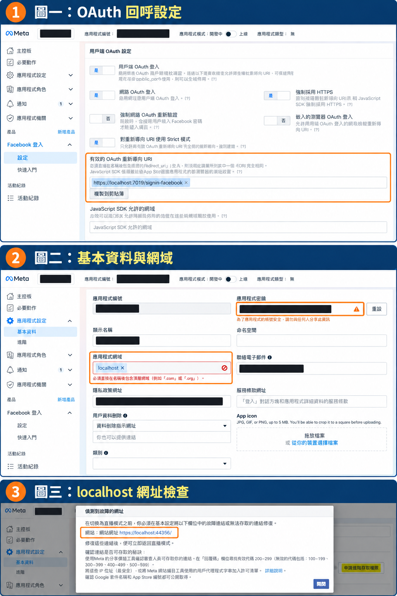

# ASP.NET Core + Vue 串接 Facebook 登入：Meta 後台設定與 localhost 常見問題

在圖書管理系統加入 Facebook 登入，除了前後端程式，也需要設定 Meta 應用程式、OAuth 回呼網址與登入權限。本文以現有 Vue 3 + ASP.NET Core 專案為例，整理本機設定流程，以及實作過程遇到的網域驗證問題。

本文是設定教學與專案流程說明，尚未以實際 Facebook 帳號完成端到端登入驗證。Meta 選單可能依應用程式類型與後台版本不同。

## 一、先分清楚登入流程中的網址

本例前端為 `http://localhost:56503`，後端為 `https://localhost:7019`。

| 用途 | 本例網址 | 誰處理 |
|---|---|---|
| 發起 Facebook 登入 | `/api/ExternalLogin/Challenge/Facebook` | 後端 Controller |
| Facebook OAuth 回呼 | `https://localhost:7019/signin-facebook` | ASP.NET Core Facebook 驗證中介軟體 |
| 授權後執行應用程式登入 | `/api/ExternalLogin/Callback/Facebook` | 後端 Controller |
| 顯示登入結果 | `http://localhost:56503/oauth/callback` | Vue 前端 |

Meta 的「有效的 OAuth 重新導向 URI」應填第二列。`/signin-facebook` 是這個驗證套件的預設回呼路徑，不需要額外建立同名 Controller。[Microsoft 官方文件](https://learn.microsoft.com/en-us/aspnet/core/security/authentication/social/facebook-logins?view=aspnetcore-8.0)

## 二、在 Meta 建立應用程式

登入 [Meta for Developers](https://developers.facebook.com/apps/)，建立應用程式並加入 Facebook 登入。本文截圖使用左側「產品 → Facebook 登入 → 設定」介面；其他版本可能從「使用案例」進入。

先維持畫面上方的「開發中」，準備使用具有應用程式角色的帳號測試。若是邀請的測試人員，請確認對方已接受邀請。

## 三、設定 Facebook Login

進入「Facebook 登入 → 設定」，確認下列欄位：

| 設定項目 | 本機設定 |
|---|---|
| 用戶端 OAuth 登入 | 是 |
| 網路 OAuth 登入 | 是 |
| 強制採用 HTTPS | 保持啟用 |
| 對重新導向 URI 使用 Strict 模式 | 保持啟用 |
| 有效的 OAuth 重新導向 URI | `https://localhost:7019/signin-facebook` |

儲存變更。若用 IIS Express 或其他連接埠啟動，必須改成實際後端網址。也應確認導向 Facebook 的授權網址中，`redirect_uri` 與這裡的設定一致。

本專案透過後端 OAuth 完成驗證，不使用 Facebook JavaScript SDK，因此不需要為此開啟「使用 JavaScript SDK 登入」。



圖一呈現 OAuth 回呼設定；圖二為基本資料的網域驗證；圖三為 Meta 無法存取 localhost 的提示。圖片為經遮蔽與排版處理的教學示意，以實際後台為準。

## 四、取得憑證，存入本機秘密設定

到「應用程式設定 → 基本資料」取得 App ID 與 App Secret。不要把 App Secret 放進 Vue 原始碼、`VITE_` 環境變數或公開文章。

在後端專案目錄執行：

```powershell
cd Library.Server
dotnet user-secrets init
dotnet user-secrets set "Authentication:Facebook:AppId" "YOUR_APP_ID"
dotnet user-secrets set "Authentication:Facebook:AppSecret" "YOUR_NEW_APP_SECRET"
```

如果專案已初始化 User Secrets，可略過 `init`。User Secrets 用於本機開發；正式部署請使用主機的秘密設定或環境變數。[設定方式](https://learn.microsoft.com/en-us/aspnet/core/security/authentication/social/facebook-logins?view=aspnetcore-8.0)

若密鑰曾出現在截圖或公開內容，應先在 Meta 重設，再更新本機設定。事後替圖片加馬賽克不會讓舊密鑰失效。

## 五、後端與前端如何接起來

既有後端的驗證設定重點如下。這是現有 Authentication 設定鏈中的片段，請勿直接取代原本的 JWT 設定：

```csharp
.AddCookie("ExternalLogin", options =>
{
    options.Cookie.SameSite = SameSiteMode.Lax;
})
.AddFacebook(options =>
{
    var config = builder.Configuration.GetSection("Authentication:Facebook");
    options.AppId = config["AppId"]!;
    options.AppSecret = config["AppSecret"]!;
    options.SignInScheme = "ExternalLogin";
    options.Scope.Add("email");
});
```

前端按鈕將使用者帶往登入入口：

```typescript
window.location.href = '/api/ExternalLogin/Challenge/Facebook'
```

本例 Vite 會將 `/api` 代理到後端。後端發起 Challenge 時，把應用程式的 Callback 指定為後續 RedirectUri；Facebook 回傳先由 `/signin-facebook` 處理，再交給 Controller 取得外部身分。

Controller 接著呼叫外部登入服務，辨識提供者識別碼、檢查帳號狀態，最後建立應用程式的登入狀態。現有專案也有依相同 email 連結帳號的行為；正式應用需另外設計帳號連結與驗證規則，不能僅因取得 email 就假定所有情況都能安全合併。

現有專案將 access token 與 refresh token 放進前端回呼 query string。正式產品建議改成短效、一次性的交換碼，或適合架構的安全 Cookie，避免長效憑證留在網址與紀錄中。

## 六、這次遇到的三個問題

### 問題 1：應用程式網域填 localhost 出現紅字

截圖中的「應用程式網域」要求包含頂層網域，`localhost` 不符合該欄位驗證。這次本機設定先移除它、留空後再儲存；如果後台仍要求網域，應依當下驗證要求使用自己可控制的測試網域。

「應用程式網域」與「OAuth 重新導向 URI」是不同欄位，後者仍需保留本機 OAuth 回呼網址。

### 問題 2：明明在開發中，卻出現「偵測到故障的網址」

這次彈窗列出的網站網址是 `https://localhost:44356/`。對 Meta 的伺服器來說，localhost 並不是開發者的電腦，因此無法用它存取本機網站。

彈窗本身只能證明該次操作觸發網站網址檢查，不能推斷應用程式已切換上線。應用程式模式要看畫面上方的狀態；這次截圖仍顯示「開發中」。

先關閉提示，完成角色帳號的本機測試。後續若要公開服務，再把網站網址換成可公開存取的 HTTPS 網址，並新增正式環境的 OAuth 回呼。

### 問題 3：public_profile 進階權限警告與 email

截圖上方顯示 `public_profile` 的進階存取提示。應用程式模式與權限存取層級是分開的設定；開發測試與一般使用者登入也應分別驗證。

本機階段先確認測試帳號的應用程式角色，若仍被權限擋住，依實際錯誤與後台「必備條件」處理。公開前，依當下後台要求完成 `public_profile`、`email` 的存取申請、資料填寫與必要驗證，不要假定切換上線就會自動取得權限。

此外，這個專案的外部登入服務在 email 為空時會拒絕登入。後台需啟用 email 權限，但請求權限仍不保證每個帳號都會回傳信箱；應保留缺少 email 的錯誤處理。[email 設定說明](https://learn.microsoft.com/en-us/aspnet/core/security/authentication/social/facebook-logins?view=aspnetcore-8.0)

## 七、實際測試順序

1. 儲存 Meta OAuth 設定與本機憑證。
2. 使用後端 HTTPS 啟動設定，確認本機憑證受信任。
3. 確認 `FrontendBaseUrl` 為 `http://localhost:56503`，前後端與資料庫皆已啟動。
4. 用具有應用程式角色的 Facebook 帳號，從前端點登入。
5. 完成授權後，確認進入系統，資料庫建立正確的外部登入關聯。
6. 再登入一次，確認識別為同一帳號；另外測試取消授權、缺少 email 與帳號停用情況。

若看到網址不允許，優先比對授權請求的 `redirect_uri`；若回到後端卻進不了前端，檢查 `FrontendBaseUrl` 與前端回呼路由。若正式部署經過反向代理，還需確認產生的回呼網址使用正確的 HTTPS 協定與公開主機名稱。

參考：[ASP.NET Core Facebook 登入官方文件](https://learn.microsoft.com/en-us/aspnet/core/security/authentication/social/facebook-logins?view=aspnetcore-8.0)、[Meta 開發者後台](https://developers.facebook.com/apps/)。
