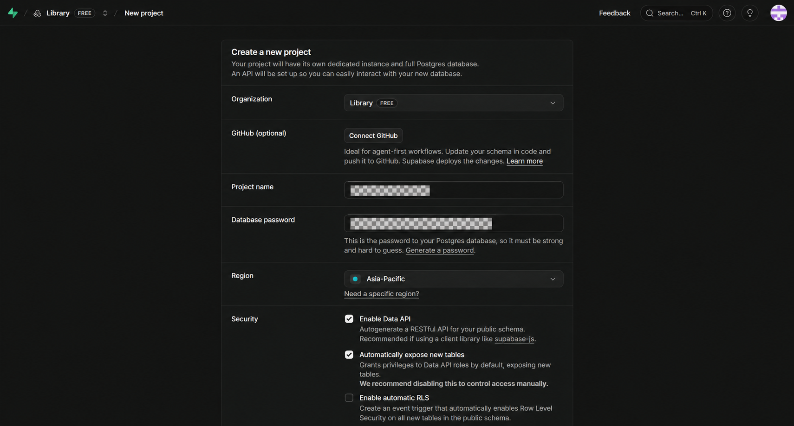
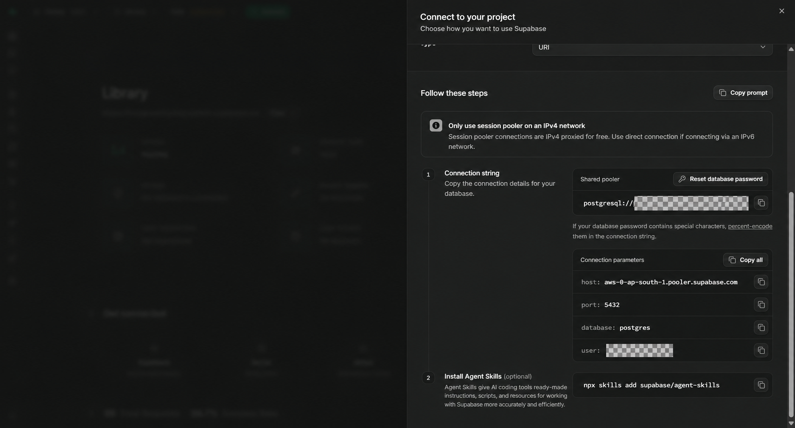
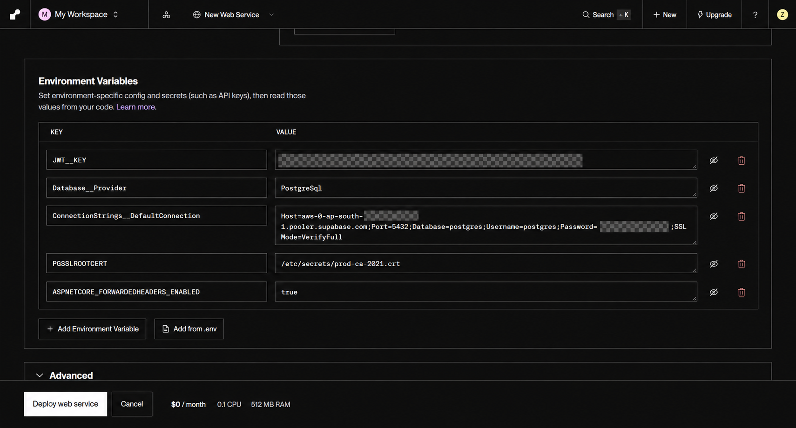
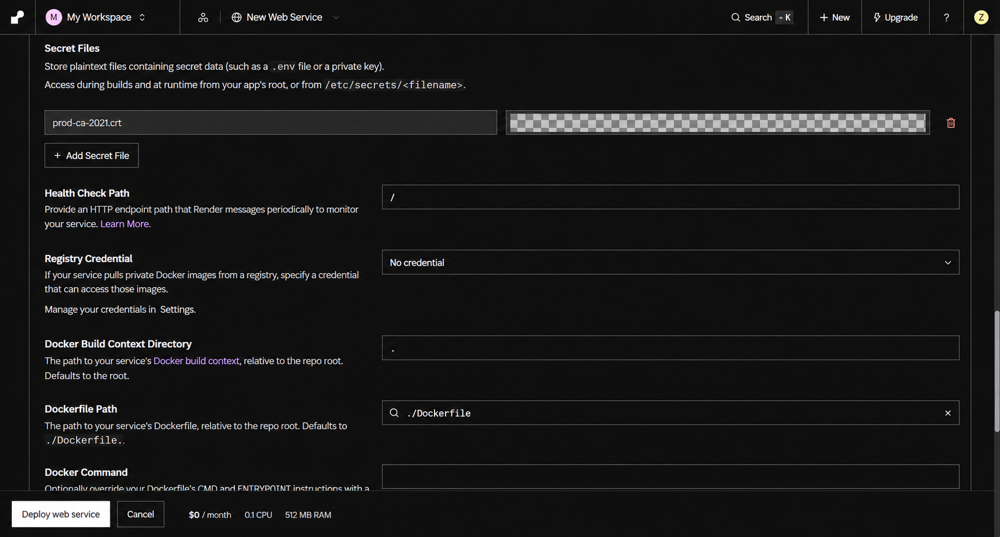
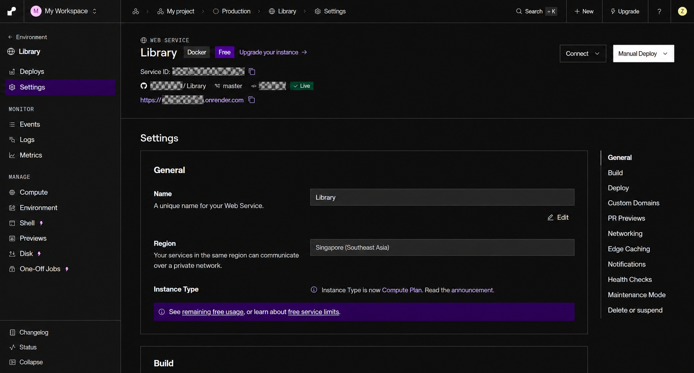

本機的圖書管理系統能運作之後，下一步就是讓其他人能從網址開啟它。這次我將 Library 的 Vue 前端與 ASP.NET Core API 包進同一個 Docker 映像，部署到 Render，再把資料庫放到 Supabase PostgreSQL。

過程中遇到幾個容易卡住的地方：Supabase 專案叫 Library，為什麼連線仍是 `Database=postgres`？關閉 Data API 後還能連資料庫嗎？Npgsql 的 SSL handshake 錯誤怎麼處理？Render 要選 Node 還是 Docker？本文依照實際操作順序整理。

本文使用 2026 年 10 月的後台介面。配圖以實際操作截圖為底，經影像工具遮蔽、重整與裁切，作為操作位置示意；設定值以文字範例為準。密碼、JWT 密鑰與連線字串均使用佔位文字，不公開實際內容。

## 一、先了解部署架構

```text
使用者瀏覽器
    │ HTTPS
    ▼
Render Web Service
    └─ Docker 容器
         ├─ Vue 編譯後的靜態網頁
         ├─ ASP.NET Core API
         └─ wwwroot/seed-books：50 張示範書封
                    │ PostgreSQL 連線＋TLS
                    ▼
          Supabase Session pooler
                    ▼
          Supabase PostgreSQL
```

| 服務 | 這次負責的內容 |
|---|---|
| GitHub 私人儲存庫 | 保存程式、Dockerfile、migration 與示範圖片 |
| Render | 取得程式、建置 Docker 映像、執行網站並提供 HTTPS 網址 |
| Supabase | 提供託管的 PostgreSQL 資料庫 |

Render 可直接從 Git 儲存庫內的 Dockerfile 建置映像，不必先推到 Docker Hub。私人 GitHub 儲存庫需先授權 Render 存取；原始碼保持私人，網站仍可以對外提供服務。[Render Docker 文件](https://render.com/docs/docker)

**本文完成的是網站與資料庫部署，尚未接上 Supabase Storage。** 種子書封隨映像發佈，使用者日後上傳的圖片則需要另外處理持久儲存。

## 二、建立 Supabase 組織與專案

登入 [Supabase Dashboard](https://supabase.com/dashboard)，若還沒有組織，先點 **New organization**。個人練習可建立名為 `Library` 的組織，方案先選 Free。

接著建立新專案：

| 欄位 | 填寫方式 |
|---|---|
| Organization | 剛建立的組織 |
| Project name | `Library`，可自行命名 |
| Database password | 產生強密碼並保存，後續資料庫連線會用到 |
| Region | 選靠近網站服務與使用者的可用區域 |
| GitHub | 此步驟可跳過；程式部署由 Render 連接 GitHub |



圖中是建立專案的初始表單，Security 的預設勾選還不是本文最後採用的設定。

### Library 為什麼關閉 Data API？

本例透過後端 Npgsql／EF Core 連接 PostgreSQL，由 Library 的 JWT 與權限機制處理應用程式存取。因此建立專案時關閉 **Enable Data API**，也不啟用 **Automatically expose new tables**；**Enable automatic RLS** 維持未勾選。

這是本架構的設定，不是所有 Supabase 專案都應照抄。若前端使用 `supabase-js` 直接讀寫資料表，就需要 Data API、資料庫授權與適當 RLS policy。官方也說明，只使用資料庫連線的應用程式可以關閉 Data API。[Supabase 資料安全文件](https://supabase.com/docs/guides/database/secure-data)

### 區域要看建立後的實際結果

這次 Supabase 選擇 Asia-Pacific 後，實際資料庫配置在 Mumbai；Render 則選 Singapore。兩者可以連線，但不是同一區域。不要把 Asia-Pacific 當成某個固定城市；建立後應確認實際位置，並衡量跨區延遲。

## 三、取得 Session pooler 連線參數

專案狀態顯示 Healthy 後，點上方 **Connect → Direct**，將 **Connection Method** 選為 **Session pooler**。



頁籤叫 Direct，不代表必須選 Direct connection。該頁仍可切換 Direct connection、Transaction pooler、Session pooler。長時間運作的後端若需要 IPv4，可使用 Session pooler；實際主機、埠號與使用者名稱以專案 Connect 面板為準。[Supabase 連線方式](https://supabase.com/docs/guides/database/connecting-to-postgres)

本例 Npgsql 使用分號格式：

```text
Host=<Session pooler 主機>;Port=5432;Database=postgres;Username=postgres.<專案代碼>;Password=<資料庫密碼>;SSL Mode=VerifyFull
```

不要直接把 `postgresql://...` URI 當成這個專案的 Npgsql 連線字串。密碼若含分號或引號，應使用 `NpgsqlConnectionStringBuilder` 正確處理，不要直接拼接破壞連線字串格式。

### 專案叫 Library，Database 為什麼是 postgres？

`Library` 是 Supabase 專案名稱；Connect 面板提供的 `postgres` 是資料庫名稱。兩者並不相同。

Library 的 Book、User、Loan 等資料表會建在 `postgres` 資料庫。除非自行建立並配置另一個資料庫，否則不能直接把連線改成 `Database=library`。

## 四、下載 CA 憑證，處理 SSL handshake

我第一次使用 `SSL Mode=VerifyFull` 連線時，遇到：

```text
Exception while performing SSL handshake
The remote certificate was rejected ...
```

這代表 TLS 憑證驗證未通過，還不能據此判斷資料庫密碼是否正確。處理方式是提供正確 CA，而不是直接關閉驗證。

在 Supabase 進入 **Database → Settings → SSL Configuration**，下載資料庫 CA 憑證。注意是 Database 的 Settings，不是 Project Settings → General。[Supabase SSL 設定](https://supabase.com/docs/guides/platform/ssl-enforcement)

本機檔案範例：

```text
C:\Users\<使用者>\Downloads\prod-ca-2021.crt
```

Npgsql 可透過連線字串的 `Root Certificate`，或環境變數 `PGSSLROOTCERT` 指定 CA 檔案。[Npgsql TLS 文件](https://www.npgsql.org/doc/security.html)

## 五、用 EF Core 在 Supabase 建表

Library 原本使用 SQL Server，本例已另外加入 PostgreSQL provider、專屬 context 及 migration。**既有 SQL Server migration 不能原封不動套到 PostgreSQL**；日期型別、索引條件與 SQL 方言需要先調整。

在專案根目錄開 PowerShell：

```powershell
$env:ConnectionStrings__DefaultConnection = 'Host=<pooler-host>;Port=5432;Database=postgres;Username=postgres.<project-ref>;Password=<database-password>;SSL Mode=VerifyFull'
$env:PGSSLROOTCERT = 'C:\Users\<使用者>\Downloads\prod-ca-2021.crt'

dotnet ef database update `
  --project Zheng.Infra.Data `
  --context PostgresLibraryContext
```

`Zheng.Infra.Data` 與 `PostgresLibraryContext` 是 Library 的專案名稱，其他專案請改成自己的 migration project 與 context。`database update` 會實際寫入目標資料庫，執行前先確認連線指向新建的雲端專案。

這次成功套用了：

```text
Applying migration '..._InitialPostgres'.
Applying migration '..._SeedDemoBooksWithCovers'.
Done.
```

第一份建立資料表；第二份新增 50 本示範書、圖片檔案紀錄、書籍圖片關聯與逐冊館藏。**資料庫中的圖片紀錄不等於實體圖片檔案**，書封實體檔稍後會跟 Docker 一起部署。

到 Supabase **Table Editor → Book** 確認資料後，清除目前 PowerShell 的暫時設定：

```powershell
Remove-Item Env:ConnectionStrings__DefaultConnection
Remove-Item Env:PGSSLROOTCERT
```

這只清除目前程序的環境變數，不會自動刪除 PowerShell 歷史紀錄。操作截圖與分享指令時仍須移除密碼。

## 六、把前後端包進 Docker

在儲存庫根目錄放 `Dockerfile`。本例採三個階段：Node 建置 Vue、.NET SDK 發佈 API，最後用 ASP.NET runtime 執行。

```dockerfile
# syntax=docker/dockerfile:1
FROM node:22-bookworm-slim AS frontend
WORKDIR /src/library.client
COPY library.client/package.json library.client/package-lock.json ./
RUN npm ci
COPY library.client/ ./
ARG VITE_API_URL=
ENV VITE_API_URL=$VITE_API_URL
RUN npm run build

FROM mcr.microsoft.com/dotnet/sdk:8.0 AS backend
WORKDIR /src
COPY Library.Server/Library.Server.csproj Library.Server/
COPY Zheng.Bll/Zheng.Bll.csproj Zheng.Bll/
COPY Zheng.Infra.Data/Zheng.Infra.Data.csproj Zheng.Infra.Data/
COPY Zheng.Mdl/Zheng.Mdl.csproj Zheng.Mdl/
RUN dotnet restore Library.Server/Library.Server.csproj -p:BuildClient=false
COPY Library.Server/ Library.Server/
COPY Zheng.Bll/ Zheng.Bll/
COPY Zheng.Infra.Data/ Zheng.Infra.Data/
COPY Zheng.Mdl/ Zheng.Mdl/
RUN dotnet publish Library.Server/Library.Server.csproj -c Release --no-restore -p:BuildClient=false -o /out
COPY --from=frontend /src/library.client/dist/ /out/wwwroot/

FROM mcr.microsoft.com/dotnet/aspnet:8.0 AS runtime
WORKDIR /app
ENV ASPNETCORE_ENVIRONMENT=Production
COPY --from=backend /out/ ./
RUN mkdir -p /app/wwwroot/uploads && chown -R $APP_UID:$APP_UID /app/wwwroot/uploads
USER $APP_UID
EXPOSE 8080
CMD ["sh", "-c", "exec dotnet Library.Server.dll --urls http://0.0.0.0:${PORT:-8080}"]
```

這份 Dockerfile 對應 Library 的資料夾結構，不是任意 .NET 專案都能直接複製使用。

### Dockerfile 之外還要配合的程式調整

1. 後端 `.csproj` 的前端專案參考加上 `Condition="'$(BuildClient)' != 'false'"`。Docker 前端已單獨建置，.NET 階段不再透過 Visual Studio JavaScript SDK 重建一次。
2. Vite 只在啟動開發伺服器時產生本機 HTTPS 憑證；正式 `vite build` 不執行 `dotnet dev-certs`。Node 階段沒有安裝 .NET SDK。
3. Axios 正式環境預設使用同站 API，例如 `import.meta.env.VITE_API_URL || ''`，避免編譯後仍呼叫使用者電腦的 localhost。
4. 後端提供靜態檔案及 `MapFallbackToFile("/index.html")`，讓 Vue 子路由重新整理後仍能開啟。
5. 未提供 Google、Facebook、LINE ID 與 secret 時，不註冊對應登入 provider，避免缺少憑證影響網站請求。

`EXPOSE 8080` 是映像的連接埠宣告；實際啟動時會讀取 Render 提供的 `PORT`，沒有設定才使用 8080。Render 要求服務監聽 `0.0.0.0`。[Render 連接埠文件](https://render.com/docs/web-services#port-binding)

### 不把本機設定與秘密包進映像

根目錄新增 `.dockerignore`，至少涵蓋：

```dockerignore
.git
.vs
.tmp
**/bin
**/obj
**/node_modules
**/dist
**/.env*
**/*.env
**/*.pfx
**/*.pem
**/*.key
**/*.crt
**/appsettings*.json
!Library.Server/appsettings.Production.json
Library.Server/wwwroot/uploads
```

只保留不含密碼的 `appsettings.Production.json`，例如 provider、JWT issuer、audience 等一般設定。資料庫密碼、JWT 簽章密鑰與 OAuth secret 在 Render 執行時提供，不要寫在 Dockerfile 的 `ENV`、build argument 或 Vue 的 `VITE_` 變數。[Render Docker 秘密設定](https://render.com/docs/docker-secrets)

本機先驗證：

```powershell
docker build -t library:render .
```

## 七、Render 連接私人 GitHub 儲存庫

先把 Dockerfile 與程式變更推送到部署分支。登入 [Render](https://dashboard.render.com/)，選 **New → Web Service**，授權讀取私人 GitHub 儲存庫，選擇 Library。

設定如下：

| 欄位 | 本例設定 |
|---|---|
| Name | `Library` |
| Language / Runtime | **Docker** |
| Branch | `master`，依自己的部署分支調整 |
| Region | 本例選 Singapore，應配合實際資料庫位置評估 |
| Root Directory | 留空 |
| Compute | 練習時先選 Free |

如果畫面出現 `Build Command: yarn`、`Start Command: yarn start`，代表仍選到 Node。請回上方將 Language 改為 Docker，不需要自行填入 yarn 指令。

## 八、設定 Render Environment Variables

可逐列新增，也可點 **Add from .env** 匯入。不要把本機 env 檔提交進 Git；密碼截圖前先隱藏。



| KEY | VALUE |
|---|---|
| `Database__Provider` | `PostgreSql` |
| `ConnectionStrings__DefaultConnection` | 前述 Npgsql 連線字串，保留 `SSL Mode=VerifyFull` |
| `JWT__KEY` | 使用 Generate 產生足夠長的隨機密鑰，至少 32 bytes |
| `PGSSLROOTCERT` | `/etc/secrets/prod-ca-2021.crt` |
| `ASPNETCORE_FORWARDEDHEADERS_ENABLED` | `true`，讓 Render 反向代理後的 API 識別 HTTPS |

最後一項用在受信任的 Render 反向代理部署環境；若自行公開容器或改用其他代理，應依網路架構限制可信任代理，不要照抄成所有環境通用的設定。

### 為什麼 JWT__KEY 有兩個底線？

.NET 讀取環境變數時，會將 `__` 換成設定層級的 `:`：

```text
JWT__KEY                              → JWT:KEY
Database__Provider                    → Database:Provider
ConnectionStrings__DefaultConnection  → ConnectionStrings:DefaultConnection
```

所以 `JWT__KEY` 對應 JSON 的 `JWT` 區塊內的 `KEY`。雙底線相容不同作業系統，是 .NET 環境變數的標準用法。[Microsoft 設定文件](https://learn.microsoft.com/en-us/aspnet/core/fundamentals/configuration/?view=aspnetcore-8.0#environment-variables)

JWT 密鑰用來簽發及驗證 Library 登入 Token，與 Supabase 資料庫密碼用途不同，不應共用。

## 九、Secret Files 與 Docker 進階欄位

展開 **Advanced → Add Secret File**：

- Filename：`prod-ca-2021.crt`。
- Contents：開啟下載的 CA 憑證，複製完整文字，包含頭尾及原始換行。

```text
-----BEGIN CERTIFICATE-----
<憑證內容>
-----END CERTIFICATE-----
```

Render 執行時會提供 `/etc/secrets/<filename>`，所以本例的 `PGSSLROOTCERT` 使用 `/etc/secrets/prod-ca-2021.crt`，不能填 Windows 的 `C:\Users\...` 路徑。[Render 環境變數與秘密檔案](https://render.com/docs/configure-environment-variables)



| 進階欄位 | 本例設定與原因 |
|---|---|
| Health Check Path | `/`，確認目前首頁能回應 |
| Registry Credential | `No credential`，本例由 GitHub 原始碼建置 |
| Docker Build Context Directory | `.`，使用儲存庫根目錄 |
| Dockerfile Path | `./Dockerfile`，不是只填 `.` |
| Docker Command | 留空，沿用 Dockerfile 的 CMD |
| Pre-Deploy Command | 留空，前面已手動執行 migration |
| Auto-Deploy | `On Commit` |
| Build Filters | 初次設定都留空 |

`/` 只是簡單的存活檢查，不會驗證資料庫已連線。若需要完整就緒檢查，可另行實作專用 health endpoint。

填完後按 **Deploy web service**。觀察建置紀錄，確認 Node build、.NET publish 和容器啟動完成，服務狀態變成 Live。

## 十、取得公開網址後設定 FrontendBaseUrl

首次部署完成，Render 會提供服務的 `onrender.com` 網址。到左側 **Manage → Environment → Edit** 新增：

```text
FrontendBaseUrl=https://<你的服務名稱>.onrender.com
```

**不要加 `/login`，也不要在結尾加 `/`。** 這個設定用在社群登入完成或失敗後導回前端；不是資料庫網址，也不是 Vue 編譯時的 API URL。



圖中目前停在 Settings，要修改環境變數應點左側 **Environment**。儲存後選擇重新部署的選項，使新設定生效。

Google、Facebook、LINE 登入仍需分別提供 ID／secret，並在各平台登記正式 HTTPS 回呼，例如 `/signin-google`、`/signin-facebook`、`/signin-line`。只設定 `FrontendBaseUrl` 並不會自動完成第三方登入配置。

## 十一、部署後怎麼確認成功？

我這次已確認公開 `/login` 頁面能顯示，Render 服務為 Live；這不能直接當成所有借還書功能都已驗證。

接下來依序檢查：

1. 透過網站帳號密碼登入，確認 API 正常連接 Supabase。
2. 書籍清單可讀取 50 本示範書，書封能正常顯示。
3. 重新整理 Vue 子路由，確認不會回傳 404。
4. 測試借閱、歸還與權限限制。
5. 若啟用社群登入，另外測試正式回呼流程。
6. 寄信、密碼重設、附件上傳分開驗證，不以登入頁能開啟當成通過。

首次使用種子管理員後，應更換預設密碼。任何已出現在公開文章、截圖或 Git 紀錄中的密碼與 JWT 密鑰，都應重設；補馬賽克只能保護這次發布的圖片，不能撤回先前曝光的內容。

## 十二、免費方案與未完成的部分

Render Free 適合練習與展示：閒置 15 分鐘會休眠，下次開啟需要等待。容器重啟、重新部署或休眠後，本機檔案變更會遺失，Free 也不能掛持久磁碟。Library 的背景提醒工作會受休眠影響，不能拿來保證準時寄出通知。[Render 免費方案限制](https://render.com/docs/free)

另外，Render Free 阻擋常用 SMTP 埠 `25`、`465`、`587`；目前 Library 使用 MailKit SMTP，因此寄信功能不能只填入一般 SMTP 設定就期待可用。需調整成支援的郵件 API，或選擇合適的付費服務配置。[Render 網路限制](https://render.com/docs/free#other-limitations)

Supabase Free 專案也可能因低活動而暫停，正式服務應另評估方案及備份。[Supabase 暫停機制](https://supabase.com/docs/guides/platform/free-project-pausing)

目前書封與上傳檔案的差別如下：

| 資料 | 現況 |
|---|---|
| 書籍、會員、借閱紀錄 | 保存在 Supabase PostgreSQL |
| 50 張種子書封 | 在映像內，每次部署都會帶上 |
| 日後使用者上傳的圖片或附件 | 仍寫容器本機，需要另接 Storage 或持久儲存 |

如果要正式提供使用者上傳，下一步應實作 Supabase Storage；這篇流程沒有完成檔案儲存遷移，也沒有搬移既有 SQL Server 資料。

## 常見問題速查

| 現象 | 優先檢查 |
|---|---|
| SSL handshake 失敗 | `VerifyFull`、CA 檔案是否完整、`PGSSLROOTCERT` 指向的檔案是否存在 |
| 密碼驗證失敗 | 使用資料庫密碼，不是 Supabase anon／service role API key |
| 找不到資料庫 library | 使用 Connect 面板的 `Database=postgres` |
| 建置畫面是 yarn / yarn start | Language 尚未切成 Docker |
| Vue 網頁呼叫 localhost | 正式版 API base URL 與前端 build 設定 |
| API 啟動提示缺少 JWT:KEY | Render 是否設定 `JWT__KEY`，名稱為雙底線 |
| 網站開啟但登入失敗 | 查 Render runtime logs、資料庫連線及 API 回應，不只看首頁 health check |
| OAuth 回到 localhost | `FrontendBaseUrl`、平台回呼網址與 forwarded headers |
| 種子書有紀錄卻沒圖片 | Docker 是否包含 `wwwroot/seed-books`，檔名大小寫是否相同 |
| 上傳圖片重啟後消失 | 容器暫存檔案系統；需另外接持久儲存 |

本文實作環境為 Vue 3、ASP.NET Core 8、EF Core 9 與 Npgsql PostgreSQL provider。雲端後台與免費方案會調整，實際操作時請同時參考官方文件與畫面。
